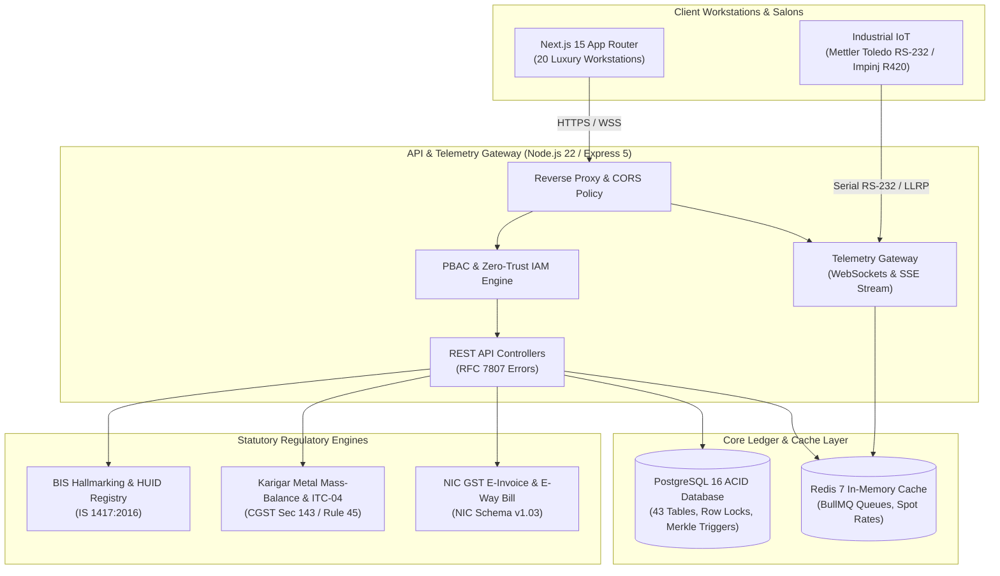

# JewelCore ERP System Architecture

This document provides a comprehensive technical breakdown of **JewelCore ERP**, its multi-tier monorepo architecture, statutory regulatory engines, zero-trust security framework, and industrial IoT telemetry pipeline.

---

## 1. High-Level System Architecture



---

## 2. Monorepo Boundaries & Dependency Topology

JewelCore enforces strict unidirectional package dependencies to guarantee modularity and prevent circular coupling:

```
@jewelcore/web  ─────┐
                     ├────► @jewelcore/shared ◄──── @jewelcore/api
@jewelcore/worker ───┘             ▲
                                   │
                           @jewelcore/database
```

| Package / App | Core Tech Stack | Operational Responsibilities |
| :--- | :--- | :--- |
| **`apps/web`** | Next.js 15 (React 19), TailwindCSS, Lucide | UI workstations, client-side PBAC route guards, dual-custody verification modals, telemetry hooks. |
| **`apps/api`** | Express 5, Node 22, Zod, pg pool | REST endpoints, JWT Argon2id issuance, RFC 7807 error handling, SSE telemetry streaming. |
| **`packages/database`** | PostgreSQL 16, pg pool, SQL migrations | Database schemas (43 physical tables), pessimistic `FOR UPDATE` concurrency locks, database triggers. |
| **`packages/shared`** | TypeScript 5.8, Zod | Shared domain DTOs, statutory calculation algorithms, ISO / IS validation schemas. |
| **`apps/worker`** | BullMQ, Redis 7, IORedis | Asynchronous background jobs, statutory IRN queue retries, BIS portal sync, customer communications. |

---

## 3. Policy-Based Access Control (PBAC) & Quorum Governance

JewelCore avoids fragile role-string comparisons by decoupling staff job titles from cryptographic **PBAC Role Tokens**:

```
Staff Operational Title                  Dynamic PBAC Token       Authorized Access Scope
──────────────────────────────────────────────────────────────────────────────────────────
Managing Director                     ─► ADMIN                 ─► Unrestricted Enterprise Master
Chief Compliance Officer              ─► ADMIN                 ─► Forensic Audit & Quorum Gate
Head Vault Custodian                  ─► MANAGER               ─► Vault Inward, Storage, GRN
Master Goldsmith & Supervisor         ─► MANAGER               ─► Atelier Karigar Orders & PBAC
Chief Bullion Trader                  ─► MANAGER               ─► MCX Spot Boards & Hedging
Senior POS Cashier                    ─► STAFF                 ─► Salon POS Checkout & E-Invoice
Senior QC Gemologist & Assayer        ─► STAFF                 ─► XRF Assays & 4Cs Gemology
BIS Hallmarking Inspector             ─► STAFF                 ─► IS 1417:2016 HUID Laser Engine
Senior Karigar Artisan                ─► STAFF                 ─► Atelier Fabrication Handoffs
```

### High-Assurance Vault Quorum (Two-Person Rule)
- Moving high-value bullion bars ($\ge ₹1,000,000$) or executing stock releases requires a **Maker-Checker co-signature**.
- The primary operator signs the transaction, generating an ephemeral cryptographic quorum token.
- A secondary authorized supervisor (`MANAGER` or `ADMIN`) must verify and co-sign the transaction payload before custody is released.

---

## 4. Database Concurrency & ACID Integrity

### Pessimistic Concurrency (`SELECT ... FOR UPDATE`)
To eliminate piece double-selling in high-traffic salons, JewelCore executes atomic row locks when reserving or transferring jewellery pieces:

```sql
-- Atomically locks piece records during checkout or transfer dispatch
SELECT id, sku, status, gross_weight_grams, selling_price
FROM pieces
WHERE id = $1 AND status = 'AVAILABLE_FOR_SALE'
FOR UPDATE;
```

### Optimistic Concurrency Control (OCC)
Master pricing matrices and vault inventory balances carry an atomic `version` column. State mutations assert matching version counters:

```sql
UPDATE rates_board
SET gold_rate_per_gram = $1, version = version + 1
WHERE id = $2 AND version = $3;
```
If version mismatch occurs, the transaction rejects with an RFC 7807 `409 Conflict` error, prompting client state re-synchronization.

### Append-Only Merkle Audit Ledger
Database trigger `INV-09` intercepts updates and deletes across financial and inventory tables, persisting immutable before-and-after JSON snapshots into `audit_logs` with SHA-256 state chaining.

---

## 5. Statutory Regulatory Engines

### BIS Hallmarking & HUID Engine (IS 1417:2016)
- **Validation**: Regex matching `^[A-Z0-9]{6}$` with alphanumeric checksum.
- **Purity Verification**: Enforces fineness benchmarks:
  - `24K`: $\ge 999$ fineness
  - `22K`: $\ge 916$ fineness
  - `18K`: $\ge 750$ fineness
  - `14K`: $\ge 585$ fineness
- **Chain of Custody**: Tracks parcel dispatches to Assaying & Hallmarking Centres (AHC) with digital certificate verification against the BIS Care portal.

### Karigar Job-Work Reconciliation & Form GST ITC-04
- **Mass-Balance Law**:
  $$\text{Issued Metal} = \text{Gross Finished Weight} + \text{Recoverable Scrap} + \text{Unaccounted Loss}$$
- **Shrinkage Tolerance Thresholds**: Configurable by manufacturing operation (Casting: $\le 1.50\%$, Filing: $\le 0.80\%$, Polishing: $\le 0.50\%$).
- **Automated Wage Deduction**: Excess loss beyond tolerance is automatically deducted from Karigar payroll evaluated at the live MCX bullion spot price.
- **Statutory Reporting**: Quarterly compilation of Form GST ITC-04 Delivery Challans detailing SAC/HSN codes and net fine weight.

### NIC GST E-Invoice & E-Way Bill Engine
- **IRN Calculation**: Computes 64-character SHA-256 hash across Seller GSTIN, Fiscal Year, Document Type, and Invoice Number.
- **Signed QR Code**: Offline B2B/B2C QR code embedding digital signatures for roadside GST inspection.
- **12-Digit E-Way Bill**: Automated distance pin-to-pin calculation with transporter ID binding for consignments exceeding statutory thresholds.

---

## 6. Industrial Hardware IoT & Telemetry

- **Mettler Toledo RS-232 Precision Balances**: Micro-gram gravimetric readings sampled at 20Hz via serial port daemon, streaming over SSE (`/api/v1/telemetry/stream`) with remote hardware auto-tare zeroing.
- **Impinj Speedway R420 UHF RFID Readers**: Multi-antenna sweeps (EPC Gen2 / ISO 18000-6C) detecting up to 400 jewellery tags/second during tray count reconciliation.
