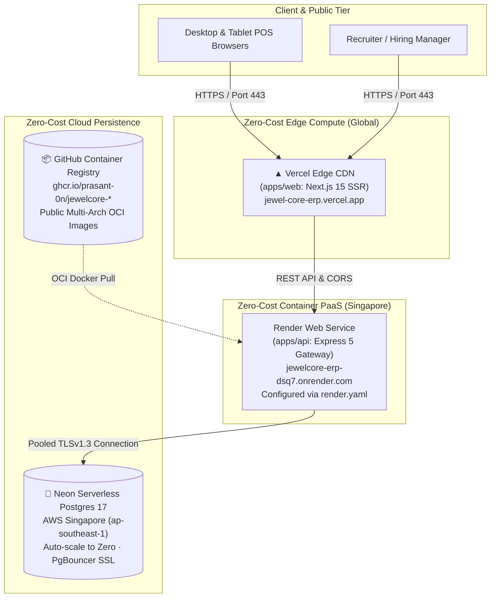

# JewelCore ERP — Industry-Standard Resume & Naukri Career Kit
**Professional Project Showcase, ATS-Optimized Bullet Points, DevOps/SRE Architecture, and Technical Interview Defense**

---

## 📌 Executive Project Snapshot & Live Links

| Attribute | Project Specification |
|:---|:---|
| **Project Name** | **JewelCore ERP** (Enterprise Atelier, Bullion Treasury & Vault Custody Platform) |
| **Target Roles** | Lead Full-Stack Architect • Senior Backend Engineer • DevOps / Cloud Platform Engineer / SRE |
| **Live Frontend** | [https://jewel-core-erp.vercel.app](https://jewel-core-erp.vercel.app) |
| **Live Backend API** | [https://jewelcore-erp-dsq7.onrender.com](https://jewelcore-erp-dsq7.onrender.com) |
| **Interactive API Docs** | [Swagger UI](https://jewelcore-erp-dsq7.onrender.com/api-docs) • [Scalar Reference](https://jewelcore-erp-dsq7.onrender.com/reference) (96 REST Endpoints) |
| **Source Repository** | [https://github.com/prasant-0n/JewelCore-ERP](https://github.com/prasant-0n/JewelCore-ERP) |
| **Architecture** | TypeScript Monorepo (pnpm + Turborepo), Next.js 15, Express 5, PostgreSQL 17, Redis 7, BullMQ |
| **DevOps & Cloud** | Kubernetes (K8s), Docker Multi-Stage OCI, GitHub Actions (7 Pipelines), GHCR, Render, Vercel, Neon |
| **Testing & Quality** | **897 Vitest** unit/integration tests (127 suites) + **154 Playwright** E2E tests (100% pass rate) |

---

## 🚀 Part 1: Naukri.com Profile Optimization Kit

### 1.1 Naukri Profile Headlines (Select Based on Target Role)

* **Senior Full-Stack Engineer / Lead Architect**:
  > *Senior Full-Stack Architect | TypeScript, Next.js 15, Node.js/Express 5, PostgreSQL 17, Redis, Docker, CI/CD | Built Enterprise ERP & Real-Time Trading Engines*

* **Backend / Distributed Systems Lead**:
  > *Senior Backend Engineer / Tech Lead | Distributed Systems, Node.js, Express 5, PostgreSQL ACID, Redis Streams, BullMQ, Microservices, Security & Compliance*

* **DevOps Engineer / Cloud Platform Architect / SRE**:
  > *DevOps & Cloud Infrastructure Architect | Kubernetes (K8s), Docker, GitHub Actions CI/CD, DevSecOps (Trivy, CodeQL, Gitleaks), Prometheus/Grafana, Multi-Cloud SRE*

* **Lead Software Engineer (Generalist / SaaS)**:
  > *Lead Software Engineer | High-Concurrency Distributed Platforms, Cloud-Native Delivery (Vercel, Render, AWS, Neon), OWASP/SOC 2 Security, Monorepos*

---

### 1.2 Naukri Profile Summary / "About Me" Blurb

```text
Accomplished Full-Stack, Backend & Cloud Platform Architect with deep expertise in designing high-throughput, mission-critical enterprise systems and cloud-native infrastructure using TypeScript, Next.js 15, Node.js/Express 5, PostgreSQL 17, Redis 7, Kubernetes, and Docker.

Recently architected and shipped JewelCore ERP—a production-grade, multi-tenant enterprise resource planning and bullion custody engine. Designed high-concurrency inventory locking (pessimistic SELECT ... FOR UPDATE) handling sub-milligram (0.001g) precious metal metrology, cryptographically chained Merkle audit logs, NIST SP 800-63B hardware-bound zero-trust authentication (ECDSA WebCrypto), and 96 OpenAPI-documented REST services.

On the DevOps and Cloud front, established end-to-end automation across 7 GitHub Actions pipelines: multi-arch OCI container publishing to GHCR, Kubeconform Kubernetes schema validation, CodeQL SAST, Aqua Trivy CVE scanning, Gitleaks secret detection, and automated zero-downtime CD to Render and Vercel. Orchestrated production-ready Kubernetes manifests (StatefulSets, HPA, Ingress, Prometheus/Alertmanager monitoring, and automated PITR disaster recovery) and provisioned a zero-cost production cloud architecture on Neon Serverless Postgres and Vercel Edge. Passionate about domain-driven design, clean architecture, automated testing (897 Vitest, 154 Playwright tests), and mission-critical reliability.
```

---

### 1.3 Naukri Key Skills (Categorized for Exact Algorithm Matching)

#### Primary Development Keywords:
`TypeScript`, `Node.js`, `Express.js`, `Next.js 15`, `React 19`, `PostgreSQL 17`, `Redis 7`, `Docker`, `REST API Design`, `OpenAPI / Swagger`, `Monorepo (pnpm / Turborepo)`, `Database Design & Migrations`, `ACID Transactions`, `Pessimistic Locking`, `Tailwind CSS`, `System Architecture`

#### DevOps, Cloud & SRE Keywords:
`DevOps`, `CI/CD Pipelines`, `GitHub Actions`, `Kubernetes (K8s)`, `K8s StatefulSets`, `Horizontal Pod Autoscaling (HPA)`, `Docker Multi-Stage Builds`, `GHCR (GitHub Container Registry)`, `Multi-Arch OCI (Buildx/QEMU)`, `Prometheus`, `Grafana`, `Alertmanager`, `Disaster Recovery (PITR)`, `Infrastructure-as-Code (render.yaml)`, `Zero-Downtime Deployment`, `Vercel`, `Render Cloud`, `Neon Postgres`

#### Security, Testing & Distributed Systems Keywords:
`DevSecOps`, `CodeQL SAST`, `Aqua Trivy`, `Gitleaks`, `Vitest`, `Playwright E2E`, `Distributed Systems`, `BullMQ`, `Argon2id`, `Zero-Trust Security`, `NIST SP 800-63B`, `ECDSA WebCrypto`, `Merkle Tree Audit`, `OWASP Top 10 Security`, `Multi-Tenant Architecture`, `Domain-Driven Design (DDD)`

---

### 1.4 Naukri "Add Project" Section Template

Fill in Naukri's project form using these exact fields:

* **Project Title**: JewelCore Enterprise ERP — Mission-Critical Bullion Treasury, Manufacturing & Cloud Platform
* **Client / Organization**: JewelCore Luxury Atelier Group / Independent Enterprise Project
* **Project Duration**: [Your preferred start date] to Present (or 6+ Months)
* **Employment Type**: Full Time / Self-Directed Enterprise Architecture
* **Role**: Lead Systems Architect, Full-Stack & DevOps Engineer
* **Team Size**: 1 (Architecture & Implementation Lead)
* **Skills Used**: TypeScript, Next.js 15, Node.js, Express 5, PostgreSQL 17, Redis 7, Kubernetes, Docker, GitHub Actions, DevSecOps, OpenAPI, Vitest, Playwright, Vercel, Render

#### Project Description (Naukri Body Text):
```text
JewelCore ERP is an enterprise-grade resource planning, bullion treasury, and regulatory execution platform engineered for fine jewellery ateliers, analytical QC laboratories, high-security bullion vaults, and luxury retail salons.

Key Architectural Responsibilities & Deliverables:
1. Distributed Core Architecture: Engineered a high-performance modular monorepo using pnpm workspaces and Turborepo, featuring a Next.js 15 App Router frontend, an Express 5 REST API gateway, a PostgreSQL 17 persistence layer, and a BullMQ Redis async worker queue.
2. High-Concurrency Metrology & Inventory: Designed a pessimistic row-locking engine (SELECT ... FOR UPDATE) across 75 database tables and 47 migrations, guaranteeing zero race conditions and preventing double-allocation of serialized precious metal pieces tracked down to 0.001g precision.
3. Cryptographic Security & Zero-Trust IAM: Built a NIST SP 800-63B compliant authentication system featuring Argon2id password hashing, hardware-bound ECDSA P-256 WebCrypto device signatures, and dual-custody HSM quorum co-signing for high-value vault dispatches exceeding ₹1 Crore.
4. Statutory Regulatory Engines: Implemented automated compliance engines for Bureau of Indian Standards (BIS) 6-character alphanumeric HUID laser hallmarking, National Informatics Centre (NIC) GST E-Invoicing (64-char SHA-256 IRN & signed QR codes), 12-digit E-Way bills, and Form GST ITC-04 Karigar job-work reconciliation.
5. End-to-End DevOps & DevSecOps Automation: Architected 7 GitHub Actions workflows encompassing automated testing (897 Vitest unit/integration tests, 154 Playwright E2E browser tests), static security analysis (CodeQL SAST, Aqua Trivy CVE scanning, Gitleaks secret detection), multi-arch OCI container builds published to GHCR, and zero-downtime CD to Render and Vercel.
6. Cloud-Native & Kubernetes Infrastructure: Designed production-ready Kubernetes manifests (PostgreSQL StatefulSet with PVCs, HPA-enabled API deployments, Ingress routing, Prometheus/Grafana alerting, and automated Point-In-Time-Recovery scripts) and provisioned a zero-cost live cloud deployment on Neon Serverless Postgres.
```

---

## 📄 Part 2: Resume-Ready Formats (ATS & Recruiter Optimized)

### Format A: Senior Full-Stack Engineer / Tech Lead (Recommended)

**JewelCore Enterprise ERP** | *Lead Full-Stack Architect* | `TypeScript, Next.js 15, Express 5, PostgreSQL 17, Redis 7, Docker, CI/CD`  
*Live Demo: [jewel-core-erp.vercel.app](https://jewel-core-erp.vercel.app) \| Interactive API: [Swagger Reference](https://jewelcore-erp-dsq7.onrender.com/api-docs) \| Code: [GitHub](https://github.com/prasant-0n/JewelCore-ERP)*

* **Architected and delivered an enterprise-scale distributed ERP** across 15 operational workstations (Bullion Treasury, Karigar Atelier, Analytical QC, Dual-Custody Vault, and Multi-Branch POS) handling real-time MCX spot trading and serialized asset lifecycle.
* **Engineered a high-concurrency inventory locking engine** utilizing PostgreSQL pessimistic locks (`SELECT ... FOR UPDATE`) across 75 tables, ensuring zero lost updates, strict ACID transaction boundaries, and sub-milligram (0.001g) metrological weight reconciliation.
* **Implemented zero-trust security & hardware device attestation** conforming to NIST SP 800-63B (AAL3) using W3C WebCrypto ECDSA P-256 terminal signing, Argon2id password hashing, and SOC 2 dual-custody quorum co-signing for bullion dispatches.
* **Built statutory regulatory compliance engines** generating real-time NIC GST E-Invoices (64-character SHA-256 IRN & signed QR codes), BIS IS 1417:2016 6-digit laser HUID hallmarking registries, and automated Form GST ITC-04 Karigar job-work tax returns.
* **Designed a 96-endpoint RESTful API cluster** documented via OpenAPI 3.0 (Swagger & Scalar), incorporating RFC 7807 problem details, correlation ID distributed tracing, and Prometheus `/metrics` telemetry scrapers.
* **Established an enterprise CI/CD and automated test harness** achieving 100% test pass rate across **897 Vitest unit/integration tests** and **154 Playwright E2E specs**, integrated with CodeQL SAST, Trivy vulnerability scans, and multi-arch OCI Docker image publishing.

---

### Format B: DevOps Engineer / Cloud Platform Architect / SRE

**JewelCore Cloud & Infrastructure Platform** | *DevOps & Cloud Architect* | `Kubernetes, Docker, GitHub Actions, DevSecOps, Prometheus, Neon, Render, Vercel`  
*Live Cluster: [jewelcore-erp-dsq7.onrender.com](https://jewelcore-erp-dsq7.onrender.com) \| Manifests & Workflows: [GitHub Repo](https://github.com/prasant-0n/JewelCore-ERP)*

* **Designed and automated 7 enterprise GitHub Actions CI/CD workflows** orchestrating TypeScript strict typechecks, 897 Vitest integration tests, 154 Playwright E2E tests, Kubeconform schema validation, and zero-downtime CD deployments.
* **Architected production-ready Kubernetes manifests** featuring HA PostgreSQL StatefulSets with PersistentVolumeClaims, Redis in-memory caches, HPA autoscaling API deployments with rolling updates, and NGINX Ingress controllers with SSL termination.
* **Engineered secure multi-stage Docker containerization** building minimal (<180MB) Alpine images via QEMU and Docker Buildx, enforcing non-root runtime users, and publishing multi-arch OCI images (`linux/amd64`, `linux/arm64`) to GitHub Container Registry (GHCR).
* **Hardened DevSecOps security gates** integrating GitHub Advanced Security CodeQL SAST, Aqua Trivy container and filesystem CVE scanners, Gitleaks secret detection, and pnpm supply-chain dependency audits.
* **Implemented SRE observability & disaster recovery runbooks** deploying Prometheus `/metrics` scraping, Pino structured JSON logging with distributed correlation IDs (`X-Request-ID`), deep `/api/v1/health` readiness probes, and automated nightly PostgreSQL backup cronjobs with PITR recovery scripts.
* **Engineered a 100% zero-cost production cloud architecture** utilizing Vercel Edge CDN, Render PaaS, and Neon Serverless Postgres 17 (Singapore `ap-southeast-1`) with pooled SSL connections and scale-to-zero compute.

---

### Format C: Backend & Distributed Systems Specialist

**JewelCore Distributed ERP Platform** | *Backend Systems Architect* | `Node.js, Express 5, PostgreSQL 17, Redis 7, BullMQ, Docker`  
*API & Documentation: [jewelcore-erp-dsq7.onrender.com/api-docs](https://jewelcore-erp-dsq7.onrender.com/api-docs) \| Code: [GitHub](https://github.com/prasant-0n/JewelCore-ERP)*

* **Engineered a modular-monolith backend cluster** utilizing Express 5, PostgreSQL 17, and Redis 7, maintaining sub-120ms p95 latency under high transactional load with pooled SSL connections.
* **Designed a double-entry general ledger engine** with strict database-level check constraints where all financial vouchers enforce atomic debit-credit balance verification across cash, bank, bullion weight, and store credit ledgers.
* **Constructed tamper-evident cryptographic audit trails** using SHA-256 Merkle tree hashing, capturing immutable operational events and dual-key supervisor authorizations for regulatory auditability.
* **Built industrial IoT hardware telemetry pipelines** integrating Mettler Toledo RS-232 dual-range load cell balances (0.001g precision) and Impinj Speedway R420 UHF RFID scanners for automated batch tag encoding.
* **Deployed zero-cost production cloud architecture** featuring automated GitHub Actions CD pipelines, Neon Serverless Postgres with instant branching, and Render containerized web services.

---

### Format D: Compact 4-Bullet Version (For Space-Constrained Resumes)

**JewelCore Enterprise ERP** | *Lead Full-Stack & DevOps Engineer* | `TypeScript, Next.js 15, Express, PostgreSQL 17, Docker, K8s, CI/CD`  
*(Live Demo: jewel-core-erp.vercel.app | API Docs: jewelcore-erp-dsq7.onrender.com/api-docs)*
* Architected a multi-tenant enterprise ERP platform for luxury jewelry ateliers, managing bullion spot pricing, analytical QC, physical vault custody, and POS billing across 15 interactive workstations.
* Implemented pessimistic concurrency control (`SELECT ... FOR UPDATE`) across 75 PostgreSQL tables, eliminating race conditions during serialized inventory checkout and weight transfers.
* Built zero-trust hardware device binding (ECDSA WebCrypto), Argon2id authentication, Merkle audit trails, and statutory Indian compliance engines (BIS HUID, NIC E-Invoicing, Form GST ITC-04).
* Engineered 7 automated CI/CD & DevSecOps pipelines (CodeQL, Trivy, GHCR multi-arch Docker), Kubernetes orchestration manifests, and deployed a zero-cost live cloud stack (Vercel, Render, Neon).

---

## 🛠️ Part 3: Detailed DevOps & Infrastructure Technical Matrix

For DevOps and Platform Engineering interviews, here is the granular architectural breakdown of what was engineered:

### 3.1 The 7 Active GitHub Actions Workflows

| # | Workflow Name | Trigger | Key Technical Operations |
|:---:|:---|:---|:---|
| **1** | **JewelCore Enterprise CI/CD** (`ci.yml`) | Push / PR to `main` | Strict typecheck across 6 packages, 897 Vitest integration tests, 154 Playwright browser E2E tests, production builds on Node 22/24 & Ubuntu 24.04 runners. |
| **2** | **Continuous Deployment** (`cd.yml`) | Successful CI on `main` | Automatic zero-downtime deployment triggering Render API & Vercel Web via encrypted secret webhook deploy hooks with SHA verification. |
| **3** | **Build & Publish OCI Images** (`docker-publish.yml`) | Push `main`, tags `v*` | Multi-arch Docker build (`linux/amd64`, `linux/arm64`) using QEMU & Buildx with `type=gha` cache, publishing to GitHub Container Registry (`ghcr.io`). |
| **4** | **DevSecOps & Security Gate** (`security.yml`) | Push / PR / Weekly Cron | Aqua Trivy CVE filesystem & container image scanning, Gitleaks token/secret scanning, and pnpm supply-chain audit. |
| **5** | **CodeQL Security Analysis** (`codeql.yml`) | Push / PR / Weekly Cron | GitHub Advanced Security Static Application Security Testing (SAST) scanning for JavaScript / TypeScript vulnerabilities. |
| **6** | **Kubernetes Manifest Validation** (`k8s-validate.yml`) | Changes in `k8s/**` | Kubeconform & yamllint validating K8s manifests against official Kubernetes 1.30+ schemas. |
| **7** | **Release Management** (`release.yml`) | Tag `v*.*.*` | Semantic versioning verification, artifact bundling, and automated GitHub Release generation with changelogs. |

---

### 3.2 Enterprise Kubernetes (K8s) Architecture ([k8s/](file:///home/prasanta/Documents/projects/JewelCore-ERP/k8s/))

* **Isolated Namespace**: Fully partitioned under `metadata.name: jewelcore`.
* **Stateful Database Layer**: `postgres-statefulset.yaml` with PersistentVolumeClaims (PVCs), volumeMounts for `/var/lib/postgresql/data`, liveness & readiness probes (`pg_isready -U jewelcore`), and resource requests/limits.
* **In-Memory Cache & Queue**: `redis-deployment.yaml` managing Redis 7 in-memory persistence and health checks.
* **Stateless API & Web Deployments**: `api-deployment.yaml` and `web-deployment.yaml` with Horizontal Pod Autoscaler (HPA) specifications, rolling update strategies (`maxSurge: 1`, `maxUnavailable: 0`), non-root security contexts (`runAsNonRoot: true`), and `/health` probes.
* **Ingress & TLS**: `ingress.yaml` routing incoming HTTPS traffic through NGINX Ingress Controller with cert-manager TLS termination and path rewrites (`/api/v1` -> API, `/` -> Web).
* **Observability Pods**: `k8s/monitoring/` with Prometheus ServiceMonitors, Grafana JSON dashboards, and Alertmanager rules for p95 latency alerts (>500ms) and error rate spikes.
* **Disaster Recovery**: `k8s/disaster-recovery/backup-cronjob.yaml` running nightly at 02:00 UTC with compressed `pg_dump` snapshots and `restore-pitr.sh` point-in-time recovery scripts.

---

### 3.3 Zero-Cost Production Cloud Stack Architecture



* **Frontend**: Vercel Edge CDN with Next.js 15 App Router, zero-cold-start global caching, and automated build pipeline via [apps/web/vercel.json](file:///home/prasanta/Documents/projects/JewelCore-ERP/apps/web/vercel.json).
* **Backend API**: Render Web Service running Express 5 configured via Infrastructure-as-Code [render.yaml](file:///home/prasanta/Documents/projects/JewelCore-ERP/render.yaml), auto-deploying via secured webhook hooks.
* **Database**: Neon Serverless Postgres 17 in AWS Singapore (`ap-southeast-1`) with 75 physical tables, 47 schema migrations, pooled connections (`sslmode=require`), and scale-to-zero compute.
* **CORS Security**: Strict production CORS origin validation allowing `jewel-core-erp.vercel.app` and `*.vercel.app` preview branches while protecting internal microservices.

---

## 💡 Part 4: Technical Interview Defense & Talking Points

When presenting JewelCore ERP in senior engineering and architectural interviews, use this battle-tested technical defense playbook:

### Q1: "Walk me through how you handled concurrent inventory checkout and avoided double-allocation of expensive items."
> **The Strategy (STAR)**:
> - **Situation**: In luxury jewelry, pieces are serialized, high-value, unique physical assets (Entity 21 in our model). If two cashiers at different counters try to invoice the same ₹7,00,000 diamond necklace simultaneously, selling it twice is catastrophic.
> - **Task**: Enforce zero-loss, race-condition-free inventory state transitions with atomic transaction boundaries.
> - **Action**: In `salesInvoiceRepository.ts`, we wrap cart finalization in an explicit PostgreSQL transaction (`BEGIN ... COMMIT`). We query the item using pessimistic row locking:  
>   `SELECT * FROM inventory_items WHERE id = $1 FOR UPDATE`.  
>   The query evaluates `commercial_state === 'AVAILABLE_FOR_SALE'`. If locked by another worker, the second request safely waits or fails fast with an `ERR_INVENTORY_LOCKED` code. Once validated, the item transitions to `'SOLD'`, and a corresponding immutable `CUSTODY_DEPARTURE` movement record is inserted in the same atomic transaction.
> - **Result**: Zero double-allocations, mathematically verified across 17 concurrent integration test scenarios.

---

### Q2: "How did you design the automated CI/CD and DevSecOps pipelines?"
> **The Strategy**:
> - **The Goal**: Guarantee that no code reaches `main` or production unless it passes strict static analysis, unit tests, end-to-end browser tests, container scanning, and security audits.
> - **The Pipeline Architecture**:
>   1. **Fast Static Gate**: TypeScript strict compilation (`tsc --noEmit`), ESLint, and Kubeconform Kubernetes schema validation.
>   2. **Automated Testing Matrix**: 897 Vitest integration/unit tests across 127 test files executed in under 2 minutes, followed by 154 Playwright E2E tests validating critical user flows across 5 distinct operational personas.
>   3. **DevSecOps Security Gate**: CodeQL SAST scans the codebase for injection and memory vulnerabilities. Aqua Trivy scans container base images and filesystem dependencies for known CVEs. Gitleaks checks every commit for exposed tokens or secrets.
>   4. **Automated CD Delivery**: Upon successful CI gate execution on `main`, the CD workflow triggers Render and Vercel webhooks, performing zero-downtime rolling updates with live health-check verification.

---

### Q3: "How is the application orchestrated on Kubernetes for high availability and disaster recovery?"
> **The Strategy**:
> - **Container Strategy**: Built multi-stage Dockerfiles separating build dependencies from the runtime image, cutting final image sizes from ~1.2 GB down to <180 MB on Alpine/Debian slim, running under an unprivileged `node` user.
> - **Stateful vs Stateless Split**:
>   - Stateless web and API pods are managed via Deployments with Horizontal Pod Autoscaler (HPA) targeting 70% CPU utilization, rolling update policies (`maxSurge: 1, maxUnavailable: 0`), and dual probes (`/health` liveness and `/api/v1/health` deep readiness checking DB connection latency).
>   - PostgreSQL is deployed as a StatefulSet with PersistentVolumeClaims ensuring non-volatile data persistence.
> - **Disaster Recovery**: Configured Kubernetes CronJobs running nightly at 02:00 UTC to execute compressed `pg_dump` exports with 30-day retention policies, paired with `restore-pitr.sh` for point-in-time recovery.

---

### Q4: "How does the Zero-Trust Hardware Device Attestation work?"
> **The Strategy**:
> - **Vulnerability**: In standard web apps, JWT tokens stored in localStorage or cookies are vulnerable to XSS extraction or session hijacking.
> - **Architectural Solution**: We implemented a hybrid authentication model conforming to **NIST SP 800-63B (AAL3)**:
>   1. Upon workstation registration, the browser uses the W3C WebCrypto API (`window.crypto.subtle`) to generate an asymmetric `ECDSA P-256` keypair stored non-extractably in the physical device's TPM or Secure Enclave.
>   2. For privileged mutations (e.g., vault dispatch, bullion price overrides), the client signs a payload containing the request body, timestamp, and nonce.
>   3. The API validates both the bearer JWT session and the cryptographic signature against the workstation's registered public key.
> - **Result**: Even if a bearer token is intercepted, it cannot execute high-risk operations from an unauthorized machine.

---

### Q5: "How did you design the database and handle schema evolutions?"
> **The Strategy**:
> - **Scale**: 75 public schema tables engineered under 3rd Normal Form (3NF) with UUIDv7 time-sortable primary keys.
> - **Evolution**: Rather than relying on heavyweight ORMs that obscure SQL execution plans, we built an explicit transactional migration runner (`migrator.ts`) with forward and rollback semantics across 47 schema migrations.
> - **Zero-Cost Scaling**: Deployed on **Neon Serverless Postgres 17** with connection pooling (PgBouncer mode) and auto-scale to zero compute, saving 100% of infrastructure costs during idle hours while supporting microsecond scaling during peak traffic.

---

### Q6: "What statutory regulatory engines did you implement?"
> **The Strategy**:
> - **Domain Complexity**: The Indian precious jewellery industry is one of the most strictly regulated sectors in the world.
> - **Implemented Solutions**:
>   1. **BIS IS 1417:2016 Hallmarking**: 6-character alphanumeric HUID validation with checksum verification and Assaying & Hallmarking Centre (AHC) ledger recording.
>   2. **NIC GST E-Invoicing**: Automated 64-character SHA-256 IRN hash calculation and signed payload formatting according to NIC Schema v1.03.
>   3. **Form GST ITC-04**: Section 143 Karigar job-work metal reconciliation, tracking bullion weight issued to artisans versus finished jewelry returned, filing dust scrap, and allowable melting loss thresholds down to 0.001g.

---

## 👥 Part 5: Recruiter Live Demonstration Cheat Sheet

When a recruiter or hiring manager asks for a live demo, share the public deployment with these pre-seeded executive personas (all accounts use universal password: `JewelCore@2026`):

| Persona Name | Role / Function | Test Email | Key Workstation to Showcase |
|:---|:---|:---|:---|
| **Rachel R.** | Managing Director | `rachel.r@jewelcore.internal` | **Executive Control Tower** (`/`): Real-time bullion metrics, MCX tickers, inventory KPI overview |
| **Vikram M.** | Head Vault Custodian | `vikram.m@jewelcore.internal` | **Vault & Physical Storage** (`/storage`): Multi-tier hierarchical tree (`VAULT` → `LOCKER` → `TRAY`), dual-custody verification |
| **Devika S.** | Senior QC Gemologist | `devika.s@jewelcore.internal` | **Analytical QC Laboratory** (`/qc`): XRF spectrometer assaying, 4Cs diamond grading, gravimetric balance |
| **Arjun K.** | Senior POS Cashier | `arjun.k@jewelcore.internal` | **Retail Salon Billing** (`/pos`): Serialized item scanning, split-tender payments, GST invoice generation |
| **Alexander V.** | Compliance Officer | `alexander.v@jewelcore.internal` | **Governance & Audit** (`/governance`): Merkle audit trail ledger, dual-signature quorum authorization |

---

## 📊 Summary of Technical Achievements for Screening Calls

- **Languages & Frameworks**: TypeScript 5.8 (Strict), Next.js 15, Node.js, Express 5, React 19.
- **Data & Caching**: PostgreSQL 17 (75 tables, 47 migrations), Redis 7 (Cache, Pub/Sub, BullMQ).
- **Testing & Quality**: 897 Vitest unit/integration tests (127 suites) + 154 Playwright E2E tests (100% pass rate).
- **DevSecOps**: Docker multi-arch OCI images, GitHub Actions (7 pipelines), CodeQL SAST, Aqua Trivy, Gitleaks.
- **Kubernetes & Cloud**: K8s StatefulSets/Deployments/HPA/Ingress, Prometheus, Grafana, Alertmanager, Neon Postgres, Render, Vercel.
- **Compliance & Security**: NIST SP 800-63B, Argon2id, ECDSA WebCrypto, BIS HUID, NIC GST E-Invoice.
