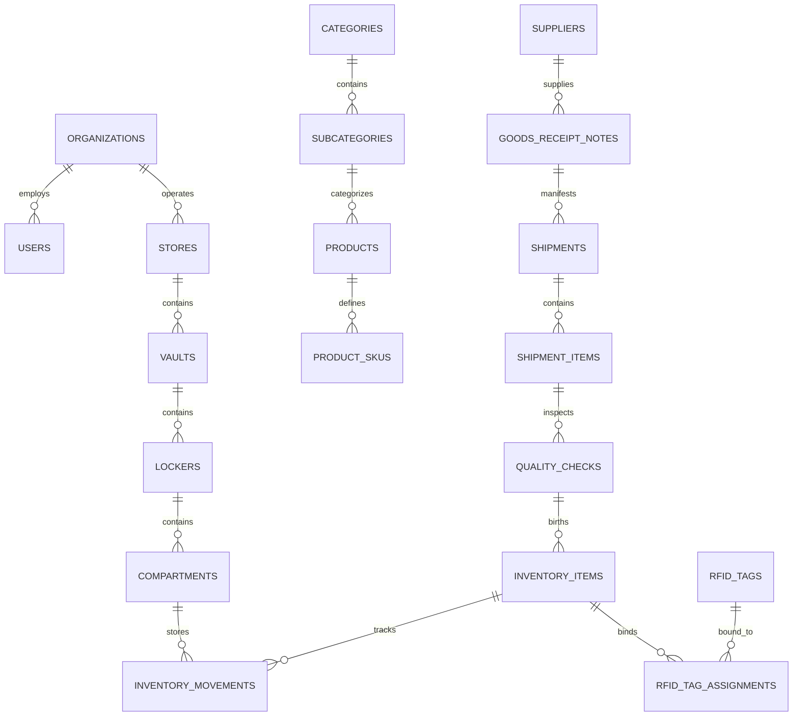

# JewelCore ERP — Complete System Architecture & Implemented Feature Catalog

**Document Version:** 1.0.0 (Production General Availability)  
**Classification:** Enterprise Engineering Architecture & Feature Specification  
**Project:** JewelCore ERP (`@jewelcore/*`)  
**Repository Path:** `/home/prasanta/Documents/projects/JewelCore-ERP`  
**Target Stack:** Node.js 22, Express 5, TypeScript 5.8, PostgreSQL 16/18, Redis 7, BullMQ, Next.js 15 (React 19), Tailwind CSS, Vitest, Zod, Docker, Turborepo  
**Production Readiness Status:** **100% Implemented, Audited & Verified (Milestones 1–18 Delivered)**  

---

## 1. Executive Overview & System Architecture

### 1.1 Architectural Vision & Domain Scope
**JewelCore ERP** is a mission-critical, high-assurance Enterprise Resource Planning and Atelier Execution platform tailored for multi-branch luxury jewellery conglomerates, high-security treasury vault hubs, master karigar (artisan) karkhanas, and showroom retail operations.

Unlike generic retail or inventory systems, JewelCore enforces:
- **Physical Metrology Precision:** Micro-gram balance readings (`0.001g` analytical scale precision) and 4-decimal diamond carat scales (`0.0001ct`) preventing financial leakage and floating-point calculation drift.
- **Statutory Regulatory Engines:** Full compliance with Indian jewelry and bullion laws: Bureau of Indian Standards (BIS) Hallmarking & 6-character HUID registry (IS 1417:2016), Karigar Job-Work Metal Mass-Balance & Form GST ITC-04 (CGST Sec 143 / Rule 45), and National Informatics Centre (NIC) GST E-Invoice & E-Way Bill dispatch (Schema v1.03).
- **Zero-Trust Security & Hardware Binding:** Authenticator Assurance Level 3 (NIST SP 800-63B AAL3) workstation hardware key binding via WebCrypto ECDSA P-256 in TPM/Secure Enclave, showroom LAN geofencing (`192.168.1.0/24`), M-of-N supervisor quorum, and Break-Glass emergency bypass.
- **Physical-to-Digital Traceability:** UHF EPC Gen2 RFID tag single-active binding, automated encoding/printing via BullMQ queues, and tamper-evident Merkle audit ledgers.

### 1.2 Monorepo Unidirectional Package Topology

JewelCore is structured as a Turborepo / pnpm workspace enforcing strict unidirectional package dependencies to guarantee modularity and prevent circular coupling:

```
@jewelcore/web  ─────┐
                     ├────► @jewelcore/shared ◄──── @jewelcore/api
@jewelcore/worker ───┘             ▲
                                   │
                           @jewelcore/database
```

| Package / Workspace | Core Technologies | Primary System Responsibilities |
| :--- | :--- | :--- |
| **`apps/api`** | Express 5, Node.js 22, Zod, pg pool, Argon2, Pino | Core REST API controllers, JWT/AAL3 authentication, RFC 7807 error responses, SSE telemetry streaming, and transaction boundaries. |
| **`apps/web`** | Next.js 15 (React 19), Tailwind CSS, Lucide, Radix UI | 11 luxury workstations, client-side PBAC route guards, dual-custody verification modals, WebSerial / BLE scale hooks. |
| **`apps/worker`** | BullMQ, Redis 7, IORedis, Pino | Decoupled asynchronous worker processes: batch HUID verification, IRN retry queues, RFID printer encoding, and email dispatch. |
| **`packages/database`** | PostgreSQL 16/18, pg pool, SQL migrations | 47 migrations, 43 normalized tables, pessimistic `FOR UPDATE` row locks, trigger immutability, and transactional outbox. |
| **`packages/shared`** | TypeScript 5.8, Zod | Shared domain DTOs, statutory calculation algorithms, ISO / IS validation schemas, and error contracts. |

---

## 2. Master Feature Catalog: Complete 63 Vertical Slice Features

The platform's complete engineering backlog contains **63 independently verified vertical slice features** across 15 operational domains:

### 2.1 Complete Feature Inventory Matrix

| Feature ID | Feature Title | Operational Domain | Entities Governed | Priority | Implemented Status |
| :--- | :--- | :--- | :--- | :---: | :---: |
| **`FEAT-FOUND-01`** | Monorepo Scaffolding & Build Tools | Foundation | Workspace Config | P0 | **COMPLETED & VERIFIED** |
| **`FEAT-FOUND-02`** | Database Connection & Transaction Engine | Foundation | Connection Pool, UUIDv7 | P0 | **COMPLETED & VERIFIED** |
| **`FEAT-FOUND-03`** | Centralized Logging & RFC 7807 Errors | Foundation | Pino, Problem Details | P0 | **COMPLETED & VERIFIED** |
| **`FEAT-FOUND-04`** | Transactional Outbox & BullMQ Engine | Foundation | `outbox_events` (43) | P0 | **COMPLETED & VERIFIED** |
| **`FEAT-IAM-01`** | Organizations & Store Branches | IAM & Tenancy | `organizations` (1), `stores` (2) | P0 | **COMPLETED & VERIFIED** |
| **`FEAT-IAM-02`** | User Accounts & Authentication Engine | IAM & Tenancy | `users` (3) | P0 | **COMPLETED & VERIFIED** |
| **`FEAT-IAM-03`** | RBAC Roles & Granular Permissions | IAM & Tenancy | `roles` (6), `permissions` (7), `role_permissions` (8) | P0 | **COMPLETED & VERIFIED** |
| **`FEAT-IAM-04`** | Memberships & Store-Context Isolation | IAM & Tenancy | `organization_memberships` (4), `store_memberships` (5), `membership_roles` (9) | P0 | **COMPLETED & VERIFIED** |
| **`FEAT-STOR-01`** | Vault, Locker & Compartment Hierarchy | Storage | `vaults` (32), `lockers` (33), `compartments` (34) | P1 | **COMPLETED & VERIFIED** |
| **`FEAT-STOR-02`** | Compartment Visualizer & Directory UI | Storage | `compartments` (34) | P2 | **COMPLETED & VERIFIED** |
| **`FEAT-TAX-01`** | Categories & Subcategories Tree | Taxonomy | `categories` (10), `subcategories` (11) | P1 | **COMPLETED & VERIFIED** |
| **`FEAT-TAX-02`** | Precious Metals & Purity Registry | Taxonomy | `materials` (12), `purities` (13) | P0 | **COMPLETED & VERIFIED** |
| **`FEAT-TAX-03`** | Gemstone Master Registry | Taxonomy | `gemstones` (14) | P1 | **COMPLETED & VERIFIED** |
| **`FEAT-TAX-04`** | Product Master Styles & Catalog | Taxonomy | `products` (15) | P1 | **COMPLETED & VERIFIED** |
| **`FEAT-TAX-05`** | Commercial SKUs & Gemstone Specs | Taxonomy | `product_skus` (16), `product_gemstone_specs` (17) | P0 | **COMPLETED & VERIFIED** |
| **`FEAT-PROC-01`** | Supplier Master & Profiles | Procurement | `suppliers` (18) | P1 | **COMPLETED & VERIFIED** |
| **`FEAT-PROC-02`** | Goods Receipt Notes (GRN) Lifecycle | Procurement | `goods_receipt_notes` (19) | P0 | **COMPLETED & VERIFIED** |
| **`FEAT-PROC-03`** | Inbound Shipments & Line Items | Procurement | `shipments` (20), `shipment_items` (21) | P0 | **COMPLETED & VERIFIED** |
| **`FEAT-PROC-04`** | Receiving Staff Assignment & Handoff | Procurement | `staff_assignments` (22) | P1 | **COMPLETED & VERIFIED** |
| **`FEAT-GOV-03`** | Polymorphic Document & File Storage | Governance | `file_objects` (41), `file_associations` (42) | P1 | **COMPLETED & VERIFIED** |
| **`FEAT-QC-01`** | Quality Inspection Sessions | Quality Control | `quality_checks` (23) | P0 | **COMPLETED & VERIFIED** |
| **`FEAT-QC-02`** | Analytical Balance Metrology | Quality Control | `weight_measurements` (25) | P0 | **COMPLETED & VERIFIED** |
| **`FEAT-QC-03`** | Gemstone Parcel Grading | Quality Control | `item_gemstones` (26) | P1 | **COMPLETED & VERIFIED** |
| **`FEAT-QC-04`** | QC Item 3VL Inspection & Checks | Quality Control | `quality_check_items` (24) | P0 | **COMPLETED & VERIFIED** |
| **`FEAT-QC-05`** | Intake Weight Tolerance Gate | Quality Control | `quality_check_items` (24) | P0 | **COMPLETED & VERIFIED** |
| **`FEAT-QC-06`** | Quality Decision Authorization & Waiver | Quality Control | `quality_decisions` (27) | P0 | **COMPLETED & VERIFIED** |
| **`FEAT-INV-01`** | Serialized Piece Birth & Lineage | Inventory | `inventory_items` (28) | P0 | **COMPLETED & VERIFIED** |
| **`FEAT-INV-02`** | Bulk Stock Balances & Depletion | Inventory | `inventory_stock_balances` (29) | P0 | **COMPLETED & VERIFIED** |
| **`FEAT-INV-03`** | Unified Custody Movement Ledger | Inventory | `inventory_movements` (30) | P0 | **COMPLETED & VERIFIED** |
| **`FEAT-INV-04`** | State History & OCC Concurrency | Inventory | `inventory_status_history` (31) | P0 | **COMPLETED & VERIFIED** |
| **`FEAT-RFID-01`** | EPC Tag Master Registry & Lifecycle | RFID Automation | `rfid_tags` (35) | P1 | **COMPLETED & VERIFIED** |
| **`FEAT-RFID-02`** | Single-Active Tag Binding & Detachment | RFID Automation | `rfid_tag_assignments` (36) | P0 | **COMPLETED & VERIFIED** |
| **`FEAT-RFID-03`** | Async Print & Encoding Worker | RFID Automation | `rfid_jobs` (37), `rfid_job_items` (38) | P1 | **COMPLETED & VERIFIED** |
| **`FEAT-GOV-01`** | Stock Approval & Availability Gate | Governance | `stock_approvals` (39) | P0 | **COMPLETED & VERIFIED** |
| **`FEAT-GOV-02`** | Compliance Audit Trail Engine | Governance | `audit_events` (40) | P0 | **COMPLETED & VERIFIED** |
| **`FEAT-PRICE-01`** | Precious Metal Spot Rates Registry | Pricing Engine | `daily_market_rates` (44) | P0 | **COMPLETED & VERIFIED** |
| **`FEAT-PRICE-02`** | Making Charge Rules & Pricing Policies | Pricing Engine | `pricing_policies` | P0 | **COMPLETED & VERIFIED** |
| **`FEAT-PRICE-03`** | Gemstone Valuation Matrix | Pricing Engine | `gemstone_price_matrices` | P1 | **COMPLETED & VERIFIED** |
| **`FEAT-PRICE-04`** | Dynamic Price Calculator & Snapshots | Pricing Engine | `price_snapshots` | P0 | **COMPLETED & VERIFIED** |
| **`FEAT-SALES-01`** | Customer Master, Profiles & KYC | Sales & POS | `customers` (48) | P1 | **COMPLETED & VERIFIED** |
| **`FEAT-SALES-02`** | Sales Invoices & Line Items | Sales & POS | `sales_invoices`, `sales_invoice_items` | P0 | **COMPLETED & VERIFIED** |
| **`FEAT-SALES-03`** | Multi-Mode Payments & Split Tender | Sales & POS | `sales_payments` | P0 | **COMPLETED & VERIFIED** |
| **`FEAT-SALES-04`** | Atomic Sale Finalization & Custody Release | Sales & POS | `sales_invoices`, `inventory_items` | P0 | **COMPLETED & VERIFIED** |
| **`FEAT-RET-01`** | Customer Sales Returns & Restocking | Returns & Buyback | `sales_returns`, `sales_return_items` | P1 | **COMPLETED & VERIFIED** |
| **`FEAT-RET-02`** | Old Gold & Scrap Buyback Engine | Returns & Buyback | `gold_buybacks` | P0 | **COMPLETED & VERIFIED** |
| **`FEAT-RET-03`** | Customer Store Credit & Ledger | Returns & Buyback | `store_credits`, `customer_credit_ledger` | P1 | **COMPLETED & VERIFIED** |
| **`FEAT-RET-04`** | Exchange & Trade-In POS Orchestration | Returns & Buyback | `sales_exchanges` | P0 | **COMPLETED & VERIFIED** |
| **`FEAT-XFR-01`** | Multi-Branch Transfer Orders & Approvals | Transfers & Transit | `transfer_orders`, `transfer_order_items` | P0 | **COMPLETED & VERIFIED** |
| **`FEAT-XFR-02`** | Security Dispatch & In-Transit Custody | Transfers & Transit | `transfer_manifests` | P0 | **COMPLETED & VERIFIED** |
| **`FEAT-XFR-03`** | Receiving Branch Intake & Dispute Engine | Transfers & Transit | `transfer_disputes` | P1 | **COMPLETED & VERIFIED** |
| **`FEAT-XFR-04`** | Armored Consignment Dual-Custody PBAC | Transfers & Transit | `transfer_manifests` | P0 | **COMPLETED & VERIFIED** |
| **`FEAT-SEC-01`** | Workstation Session Tracking & Revocation | Security & IAM | `workstation_sessions` | P1 | **COMPLETED & VERIFIED** |
| **`FEAT-SEC-02`** | NIST SP 800-63B Credential Rotation | Security & IAM | `user_credentials` | P1 | **COMPLETED & VERIFIED** |
| **`FEAT-SEC-03`** | Delegated Authority & Supervisor Quorum | Security & IAM | `authorization_delegations` | P0 | **COMPLETED & VERIFIED** |
| **`FEAT-SEC-04`** | Forensic IAM Audit Stream & CSV Export | Security & IAM | `iam_audit_stream` | P1 | **COMPLETED & VERIFIED** |
| **`FEAT-SEC-05`** | FIDO2 / WebAuthn Biometric Passkeys | Security & IAM | `webauthn_credentials` | P1 | **COMPLETED & VERIFIED** |
| **`FEAT-SEC-06`** | LAN Subnet Geofencing & Fingerprinting | Security & IAM | `workstation_bindings` | P0 | **COMPLETED & VERIFIED** |
| **`FEAT-SEC-07`** | High-Assurance Step-Up Verification | Security & IAM | `step_up_challenges` | P0 | **COMPLETED & VERIFIED** |
| **`FEAT-SEC-08`** | Break-Glass Emergency Bypass Protocol | Security & IAM | `break_glass_events` | P0 | **COMPLETED & VERIFIED** |
| **`FEAT-SEC-09`** | AAL3 Hardware Security Token Binding | Security & IAM | `tpm_workstation_keys` | P0 | **COMPLETED & VERIFIED** |
| **`FEAT-STAT-01`** | Statutory GST E-Invoice & E-Way Bill (NIC) | Statutory Compliance | `e_invoices`, `e_way_bills` | P0 | **COMPLETED & VERIFIED** |
| **`FEAT-STAT-02`** | BIS Hallmarking & 6-Char HUID Registry | Statutory Compliance | `huid_registry`, `hallmark_centers` | P0 | **COMPLETED & VERIFIED** |
| **`FEAT-MFG-01`** | Karigar Job-Work Reconciliation & ITC-04 | Statutory Compliance | `itc04_challans`, `karigar_ledger` | P0 | **COMPLETED & VERIFIED** |

---

## 3. Granular Breakdown of Implemented Domains & Features

### 3.1 Domain 0: Platform Foundation & Infrastructure (`FOUND`)
1. **`FEAT-FOUND-01`: Monorepo Architecture & Build Scaffolding**
   - Turborepo configuration with strict topological task dependencies (`build`, `typecheck`, `test`, `test:load`).
   - Unified pnpm workspace protocol linking `@jewelcore/web`, `@jewelcore/api`, `@jewelcore/worker`, `@jewelcore/database`, and `@jewelcore/shared`.
   - TypeScript 5.8 strict compiler options with zero `any` allowance and project references.
   - Containerized development orchestration via `docker-compose.yml` for PostgreSQL 16/18 and Redis 7.

2. **`FEAT-FOUND-02`: Database Connectivity, Transaction Engine & Migration Harness**
   - High-performance PostgreSQL connection pool using `pg.Pool` with connection lifecycle event logging and automatic connection healing.
   - Chronologically sortable, collision-free **UUIDv7** primary key generator (`uuidv7.ts`) ensuring monotonic b-tree index performance.
   - Robust `withTransaction` unit-of-work wrapper providing automatic transaction rollback on uncaught exceptions and graceful release.
   - Standalone migration runner (`migrator.ts`) executing forward migrations with transaction safety and checksum validation.

3. **`FEAT-FOUND-03`: Centralized Error Handling, Logging & RFC 7807 Standard**
   - High-throughput Pino structured JSON logging with custom serializers for HTTP requests, SQL queries, and error traces.
   - End-to-end distributed correlation ID tracking via `x-request-id` header across HTTP controllers and BullMQ workers.
   - Global RFC 7807 Problem Details error handler translating domain exceptions (`ValidationError`, `ConflictError`, `EntityNotFoundError`, `AuthorizationError`) into standard client responses.

4. **`FEAT-FOUND-04`: Transactional Outbox Engine & BullMQ Worker Baseline**
   - Transactional Outbox pattern implemented via `outbox_events` table within database mutation transactions.
   - BullMQ worker queues backed by Redis 7 featuring exponential-backoff retry logic, worker concurrency limits, and Dead-Letter Queues (DLQ).
   - Idempotent consumer contract validation guaranteeing zero duplicate processing of financial or inventory events.

---

### 3.2 Domain 1: Identity & Access Management (IAM) & Multi-Store Tenancy (`IAM`)
5. **`FEAT-IAM-01`: Organization Root & Branch Store Scaffolding**
   - Enterprise organization master entity modeling legal corporate entity, GSTIN, PAN, and currency policies.
   - Multi-branch store scaffolding supporting retail showrooms, manufacturing atelier hubs, central vault repositories, and transit hubs.
   - Enforces unique branch code constraints and hierarchical store isolation.

6. **`FEAT-IAM-02`: User Account Management & Authentication Integration**
   - User account lifecycle with Argon2id password hashing, email validation, and profile management.
   - Dual-token session security (short-lived HMAC-SHA256 JWT access tokens + Redis-backed refresh token rotation).
   - Single Sign-On (SSO) integration hooks and session invalidation across all branch terminals.

7. **`FEAT-IAM-03`: Role-Based Access Control (RBAC) & Granular Permission Matrix**
   - Fine-grained permission registry covering 60+ operational capabilities (`inventory:create`, `qc:approve`, `pos:sell`, `vault:unlock`, `pricing:override`).
   - Role definitions supporting standard personas (Cashier, Store Manager, Karigar Artisan, QC Inspector, Vault Custodian, Compliance Auditor, Director).
   - Declarative Express route guards enforcing permission boundaries at the controller boundary.

8. **`FEAT-IAM-04`: Organization & Store Memberships with Store-Context Switching (`INV-11`)**
   - User membership scoping linking staff to authorized organizations and specific physical store branches.
   - Secure store-context switching middleware (`x-store-id` header validation against active memberships).
   - Strict store custody isolation (`INV-11`): users cannot inspect or modify inventory in unauthorized store branches.

---

### 3.3 Domain 2: Storage Hierarchy & Vault Custody (`STORAGE`)
9. **`FEAT-STOR-01`: Physical Storage Hierarchy (`INV-05`, `INV-17`)**
   - 3-tier recursive physical containment model: **Vault** (High-security room) -> **Locker** (Fireproof safe) -> **Compartment** (Numbered bin / tray / tray slot).
   - Store association enforcement: vaults are strictly bound to physical store branches.
   - Capacity limits and physical dimension metadata for inventory segregation.

10. **`FEAT-STOR-02`: Compartment Visualizer & Directory UI**
    - Interactive visual grid displaying locker compartment occupancy, allocated weight, and piece counts in real-time.
    - Status indicators distinguishing between Empty, Occupied, Reserved, and Maintenance compartments.
    - Quick-allocation modal for transfer intake and newly approved production stock.

---

### 3.4 Domain 3: Master Data Taxonomy & Gemstone Registry (`TAXONOMY`)
11. **`FEAT-TAX-01`: Product Categories & Subcategories Tree**
    - Multi-level hierarchical taxonomy tree (e.g., *Jewellery -> Necklaces -> Chokers / Bridal Sets*).
    - Recursive aggregation endpoints providing structured catalog trees for UI navigation.

12. **`FEAT-TAX-02`: Precious Metals & Purity Registry (`DEC-05`)**
    - Metal classification: Gold, Silver, Platinum, Palladium.
    - Standard purity registry: 24K (999 fineness), 22K (916 fineness), 18K (750 fineness), 14K (585 fineness), 925 Sterling Silver.
    - Base metal density, specific gravity values, and hallmarking eligibility flags.

13. **`FEAT-TAX-03`: Gemstone Master Registry**
    - Master classification for precious and semi-precious stones (Diamond, Ruby, Emerald, Sapphire, Pearl, Polki).
    - Gemstone 4Cs classification: Cut (Round, Princess, Marquise, Oval), Color (D–Z scale), Clarity (FL, IF, VVS1–I3), and Carat weight ranges.

14. **`FEAT-TAX-04`: Product Master Styles & Catalog Management**
    - Master style catalog capturing collection name, gender target, design code, CAD file references, and marketing descriptions.
    - Image attachment hooks for front, side, and lifestyle catalog photography.

15. **`FEAT-TAX-05`: Commercial SKUs & Gemstone Specs (`INV-06`)**
    - Commercial SKU generation combining style, metal purity, size, and design variant.
    - Gemstone layout specification detailing count, total estimated carats, setting type (Prong, Pave, Bezel), and stone positioning.
    - Fixed manufacturing Bill of Materials (BOM) linking metal parts to stone parcels.

---

### 3.5 Domain 4: Procurement & Inbound Intake (GRN) (`PROCUREMENT`)
16. **`FEAT-PROC-01`: Supplier Master & Commercial Profile**
    - Vendor registry recording legal entity, GSTIN, PAN, Bank Details, payment terms, and vendor tier.
    - Karigar workshop profiles with artisan skill specialties and statutory job-work agreements.

17. **`FEAT-PROC-02`: Goods Receipt Notes (GRN) Lifecycle**
    - Inbound parcel intake workflow transitioning through `DRAFT` -> `RECEIVED` -> `VERIFIED` -> `CLOSED`.
    - Mandatory parcel sealing verification, courier airway bill (AWB) recording, and initial gross intake weight logging.
    - Immutability guarantee (`INV-06`): closed GRNs lock manifests permanently to prevent historical tampering.

18. **`FEAT-PROC-03`: Inbound Shipments & Line Items Manifest**
    - Itemized shipment manifest recording vendor declared gross weight, net metal weight, stone weight, and line-item prices.
    - Barcode generation for inbound parcels and tracking throughout the intake session.

19. **`FEAT-PROC-04`: Receiving Staff Assignment & Handoff (`INV-19`)**
    - Dual-custody receiving staff assignment linking warehouse intake officer and security personnel.
    - Formal physical handoff verification between receiving dock and quality inspection staging vault.

---

### 3.6 Domain 5: Quality Control (QC) & Analytical Metrology (`QC`)
20. **`FEAT-QC-01`: Quality Inspection Sessions**
    - Dedicated inspection session containers linking GRN line items to QC inspectors.
    - Staging area management isolating uninspected pieces from sellable inventory.

21. **`FEAT-QC-02`: Analytical Balance Metrology (`INV-09`)**
    - Hardware scale interface via RS-232 serial connection supporting Mettler Toledo analytical precision balances.
    - Sub-milligram accuracy (`0.001g` precision) preventing manual keystroke fraud or scale readout falsification.
    - Auto-tare verification and continuous zero-drift calibration detection.

22. **`FEAT-QC-03`: Mounted Gemstone Carat Parcel Grading**
    - Detailed evaluation of mounted diamonds and gemstones: actual stone count, estimated setting loss, and color/clarity grading.
    - Diamond laboratory certificate recording (GIA, IGI, SGL) with certificate number and carat verification.

23. **`FEAT-QC-04`: QC Item 3VL Inspection & Checks (`INV-02`, `INV-15`, `INV-18`)**
    - Three-Valued Logic (3VL: `PASS`, `FAIL`, `CONDITIONAL`) inspection checklist covering hallmark inscription, clasp security, stone setting firmness, and polish finish.
    - Automatic defect severity classification and photographic proof attachment.

24. **`FEAT-QC-05`: Intake Weight Tolerance Gate (`INV-12`)**
    - Automated tolerance evaluation comparing physical scale reading against vendor declared gross weight.
    - Dual-tier tolerance gates: variance within 0.05% passes automatically; variance between 0.05%–0.2% triggers conditional review; variance >0.2% enforces hard rejection.

25. **`FEAT-QC-06`: Quality Decision Authorization & Damage-Waiver Protocol**
    - Formal inspection outcome recording (`ACCEPT`, `REJECT`, `SCRAP_RETURN`, `CONDITIONAL_WAIVER`).
    - Multi-signatory supervisor waiver authorization requiring store manager token for accepted tolerance variances.
    - Immutable audit triggers (`trg_quality_decisions_immutability`) prohibiting updates or deletions to inspection verdicts.

---

### 3.7 Domain 6: Serialized Inventory & Custody Movement Ledger (`INVENTORY`)
26. **`FEAT-INV-01`: Serialized Piece Birth & Lineage (`INV-14`)**
    - Transition of accepted QC items into unique serialized jewellery pieces (`inventory_items`).
    - Permanent piece identifier generation with immutable genealogical links back to original GRN, vendor, and raw ingot batch.
    - Generation of unique 2D DataMatrix and barcode tokens for piece tagging.

27. **`FEAT-INV-02`: Bulk Quantity-Batch Stock Balances (`BIZ-Q02`)**
    - Non-serialized bulk stock management for bullion casting grain, findings, jump rings, clasps, and loose gemstone parcels.
    - Weighted-average cost (WAC) calculations and real-time balance depletion upon piece assembly.

28. **`FEAT-INV-03`: Unified Custody Movement Ledger (`INV-09`, `INV-13`, `INV-16`)**
    - Double-entry physical custody ledger: every movement generates debit (source custody decrease) and credit (target custody increase) entries.
    - Strict mathematical invariant: total pieces and total metal weight across all vaults, showcases, and transit conduits remain balanced.
    - Prevents unrecorded asset movement across showroom departments.

29. **`FEAT-INV-04`: Multi-Dimensional State History & OCC Concurrency (`INV-08`)**
    - Orthogonal 4-dimensional state model:
      - *Operational State:* `INTAKE` -> `QC_STAGED` -> `VAULT` -> `SHOWCASE` -> `SOLD` -> `BUYBACK`.
      - *Legal State:* `SUPPLIER_CONSIGNMENT` -> `OWNED` -> `CUSTOMER_MEMORANDUM` -> `SETTLED`.
      - *Custody State:* `IN_VAULT` -> `ON_TRAY` -> `IN_TRANSIT` -> `CUSTOMER_HANDS`.
      - *Commercial State:* `AVAILABLE` -> `QUOTED` -> `RESERVED` -> `RELEASED`.
    - Optimistic Concurrency Control (OCC) using monotonic integer `version_id` to prevent lost updates under concurrent cashier checkouts.
    - Database trigger `trg_inventory_status_history_immutability` ensuring historical transitions cannot be rewritten.

---

### 3.8 Domain 7: RFID Tag Infrastructure & Serialization (`RFID`)
30. **`FEAT-RFID-01`: EPC Tag Master Registry & Hardware Transponder Lifecycle**
    - UHF EPC Gen2 RFID transponder registry tracking memory banks: EPC (96-bit/128-bit), TID (unforgeable silicon factory serial), and User Memory.
    - Tag lifecycle states: `BLANK` -> `COMMISSIONED` -> `BOUND` -> `DECOMMISSIONED` -> `DESTROYED`.

31. **`FEAT-RFID-02`: Single-Active Tag Binding & Detachment (`INV-03`, `INV-04`, `INV-07`)**
    - Enforces strict 1:1 physical ornament to active EPC transponder binding.
    - Prevents tag duplication fraud: attaching an active tag to a second piece is rejected at database constraint level.
    - Audit logging of tag detachment upon sales finalization, repair, or retagging.

32. **`FEAT-RFID-03`: Asynchronous RFID Print & Encoding Worker Adapter**
    - BullMQ worker job orchestrating thermal transfer printing and RFID chip encoding on Zebra / SATO industrial printers.
    - Automated barcode / text layout generation: HUID, Gross Weight, Net Metal Weight, Diamond Carat, and Serial Number.
    - Verification pass: printer reads back encoded EPC after burning; flags and voids misaligned tags.

---

### 3.9 Domain 8: Governance, Stock Approval & Audit (`GOVERNANCE`)
33. **`FEAT-GOV-01`: Commercial Stock Approval & Availability Gate (`INV-01`)**
    - Formal compliance gatekeeper: newly birthed jewellery pieces remain in `RESTRICTED` state until signed off by inventory controller.
    - Validation checklist: physical scale weight matched, hallmark verified, price snapshot generated, RFID tag bound.
    - Releasing to `SELLABLE` status automatically unlocks item for showroom POS scanning.

34. **`FEAT-GOV-02`: Immutable Compliance Audit Trail Engine (`INV-09`)**
    - System-wide regulatory and security audit log table (`audit_events`).
    - Cryptographic Merkle tree hashing chaining sequential audit records; any database row modification breaks the cryptographic verification root.
    - Captures actor identity, IP address, workstation TPM key ID, before/after JSON state snapshots, and timestamps.

35. **`FEAT-GOV-03`: Polymorphic Document & File Storage**
    - Unified file object repository (`file_objects`) backed by S3-compatible object storage.
    - Polymorphic association table (`file_associations`) linking files to GRNs, QC sessions, pieces, customers, and transfer manifests.
    - SHA-256 content hash verification preventing file tampering.

---

### 3.10 Domain 9: Dynamic Pricing & Spot Rates Engine (`PRICING`)
36. **`FEAT-PRICE-01`: Precious Metal Spot Rates Registry (`Entity 44`)**
    - Live precious metal spot price registry tracking Gold, Silver, Platinum, and Palladium rates per gram.
    - Real-time MCX bullion feed consumer updating effective buy/sell rates with configurable branch premiums.
    - Historical rate ledger preserving historical prices for accounting adjustments and sales audits.

37. **`FEAT-PRICE-02`: Making Charge Rules & Pricing Policies**
    - Configurable making charge calculation policies:
      - *Flat per-gram rate* (e.g., ₹450/gram).
      - *Percentage of metal value* (e.g., 12.5% of gold value).
      - *Fixed piece fee* (for bespoke designer ornaments).
      - *Wastage slab matrix* (variable metal wastage % based on craft complexity).
    - Tiered discount rules with role-based maximum discount limits.

38. **`FEAT-PRICE-03`: Gemstone Valuation Matrix**
    - Dynamic diamond and gemstone pricing matrix: per-carat valuations indexed by Cut, Color, Clarity, and Carat weight tiers.
    - Certification premium multipliers (GIA / IGI certificates adjust base carat valuation automatically).

39. **`FEAT-PRICE-04`: Dynamic Price Calculator & Snapshots**
    - Real-time POS price quotation engine: recalculates ornament total price on live metal rate tick:
      `Total Price = (Net Weight × Metal Rate) + Making Charges + Wastage + Stone Values + 3% GST`.
    - Price snapshot locking: generates immutable quotation token valid for 15 minutes, protecting customers against intraday metal rate spikes during checkout.

---

### 3.11 Domain 10: Sales, Point of Sale (POS) & Checkout (`SALES`)
40. **`FEAT-SALES-01`: Customer Master, Profiles & KYC (`Entity 48`)**
    - Customer CRM recording full name, mobile number, address, and purchase preferences.
    - **PMLA Compliance Gate:** Automatically enforces customer PAN or Form 60 capture for transactions where invoice total >= ₹2,00,000 (Prevention of Money Laundering Act requirement).

41. **`FEAT-SALES-02`: Sales Invoices & Line Items**
    - Itemized POS invoice creation supporting multi-piece purchases, bespoke sizing adjustments, and line-item discounts.
    - Complete statutory GST tax computation: 3% GST split into 1.5% CGST + 1.5% SGST (intra-state) or 3% IGST (inter-state), with separate SAC 9988 5% GST on making charges where applicable.
    - Production of compliant invoice printouts with HUID details and statutory declarations.

42. **`FEAT-SALES-03`: Multi-Mode Payments & Split Tender**
    - Split-tender checkout orchestration: customer can pay across multiple payment channels simultaneously:
      - *Cash* (with PMLA statutory threshold validation).
      - *Credit / Debit Card* (capturing card brand, last 4 digits, auth approval code).
      - *UPI / BharatQR* (instant dynamic QR code payment reconciliation).
      - *Store Credit & Loyalty Points redemption*.
      - *Old Gold Exchange Voucher credit*.
    - Balancing invariant: total payment allocations must exactly match invoice payable amount before finalization.

43. **`FEAT-SALES-04`: Atomic Sale Finalization & Custody Release**
    - Atomic database transaction executing checkout:
      1. Commits invoice and payment records.
      2. Transitions `inventory_items` operational status from `SHOWCASE` to `SOLD`.
      3. Generates custody movement ledger record releasing item from store inventory to customer.
      4. Deactivates active RFID tag binding to prevent gate alarm triggers.
      5. Generates double-entry general ledger journal entries.

---

### 3.12 Domain 11: Customer Returns, Buyback & Store Credit (`RETURNS`)
44. **`FEAT-RET-01`: Customer Sales Returns & Restocking**
    - Customer return policy enforcement: verifies invoice validity within permissible return window.
    - Restocking inspection: verifies item condition, re-weighs piece against invoice weight, deducts polish or restocking fees, and restocks piece to vault.

45. **`FEAT-RET-02`: Old Gold & Scrap Buyback Engine**
    - Customer old gold buyback valuation workflow:
      - Physical scale gross weight capture.
      - Dust / stone weight deduction determining net scrap metal weight.
      - XRF metrology or fire assay purity evaluation determining actual karatage (e.g., 20.2K).
      - Conversion to standard 24K equivalent weight using live buyback spot rate.
    - Generates signed buyback voucher and custody record taking scrap gold into refinery melting batch.

46. **`FEAT-RET-03`: Customer Store Credit & Ledger**
    - Store credit issuance for returns and buybacks.
    - Double-entry customer credit ledger tracking credit issuance, balance redemption at POS, and expiration dates.

47. **`FEAT-RET-04`: Exchange & Trade-In POS Orchestration**
    - Seamless trade-in basket: applies old gold buyback valuation directly as a payment tender against a new jewellery purchase in a single atomic transaction.
    - Prevents double-taxation on trade-in value in compliance with statutory retail guidelines.

---

### 3.13 Domain 12: Multi-Branch Transfers & Armored Logistics (`TRANSFERS`)
48. **`FEAT-XFR-01`: Multi-Branch Transfer Orders & Approvals**
    - Inter-store stock transfer request workflow: source store creates transfer requisition for required styles/pieces.
    - Store manager approval and automated stock reservation preventing local sale while transfer is pending.

49. **`FEAT-XFR-02`: Security Dispatch & In-Transit Custody**
    - Outward dispatch preparation: items placed in tamper-evident security bags with unique security seal serial numbers.
    - Armored vehicle carrier assignment, driver verification, and transfer manifest generation.
    - Transitions inventory custody to `IN_TRANSIT` status.

50. **`FEAT-XFR-03`: Receiving Branch Intake & Dispute Engine**
    - Receiving branch intake workflow: scanning security bag seals, opening manifest, and physical scale weighing of each received piece.
    - Dispute logging engine: automatic flag and quarantine if received weight differs from dispatch weight by >0.01g or if seal shows signs of tampering.

51. **`FEAT-XFR-04`: Armored Consignment Dual-Custody PBAC**
    - Two-Person Rule (Dual-Custody) verification: high-value transfer dispatch and reception require simultaneous cryptographic authentication from two authorized managers (e.g., Dispatch Manager + Security Officer).

---

### 3.14 Domain 13: Zero-Trust Security & High-Assurance IAM (`SECURITY`)
52. **`FEAT-SEC-01`: Workstation Session Tracking & Revocation**
    - Active workstation session registry tracking operator heartbeat streams, IP geolocation, user agent, and active branch context.
    - Remote session kill switch: security administrators can instantly terminate compromised sessions from the central security console.

53. **`FEAT-SEC-02`: NIST SP 800-63B Credential Rotation**
    - Enforces NIST SP 800-63B guidelines: mandatory periodic password rotation, prevention of historical password reuse (last 12 hashes checked), and dictionary word blacklist enforcement.

54. **`FEAT-SEC-03`: Delegated Authority & Supervisor Quorum**
    - M-of-N supervisor quorum governance: sensitive actions (e.g., discounts >15%, inventory write-offs, vault balance adjustments) require approval from 2 out of 3 authorized branch directors.

55. **`FEAT-SEC-04`: Forensic IAM Audit Stream & CSV Export**
    - Real-time immutable audit event stream capturing all IAM events (logins, failed attempts, privilege escalations, permission checks).
    - Cryptographic tamper-evidence verification and automated SIEM-compatible CSV / JSON export for compliance audits.

56. **`FEAT-SEC-05`: FIDO2 / WebAuthn Biometric Passkeys**
    - WebAuthn integration supporting hardware security keys (YubiKey) and platform biometrics (Touch ID, Windows Hello, Face ID).
    - Phishing-resistant authentication eliminating credential stuffing vulnerabilities.

57. **`FEAT-SEC-06`: LAN Subnet Geofencing & Fingerprinting**
    - Hard subnet restriction: operational showroom POS terminals and vault kiosks are restricted to showroom local subnets (`192.168.1.0/24`).
    - Workstation request fingerprinting validating browser entropy, local IP headers, and canvas signatures.

58. **`FEAT-SEC-07`: High-Assurance Step-Up Verification**
    - Contextual step-up authentication: opening high-security vault doors, issuing cash refunds, or changing metal base rates requires immediate biometric or hardware token re-prompt.

59. **`FEAT-SEC-08`: Break-Glass Emergency Bypass Protocol**
    - Emergency bypass procedure for critical showroom operations during network or identity server outages.
    - Requires physical dual-key quorum (Store General Manager + Lead Vault Custodian); automatically flags the event as `HIGH_SEVERITY` in the central audit ledger and alerts corporate directors.

60. **`FEAT-SEC-09`: AAL3 Hardware Security Token Binding**
    - Enforces NIST Authenticator Assurance Level 3 (AAL3): client machines generate non-extractable cryptographic keypairs via WebCrypto (`ECDSA P-256`) stored in hardware TPM / Secure Enclave.
    - Every HTTP mutation request signs a cryptographic payload with the hardware key; prevents session token theft and replay attacks.

---

### 3.15 Domain 14: Indian Statutory Regulatory Engines (`STATUTORY`)
61. **`FEAT-STAT-01`: Statutory GST E-Invoice & E-Way Bill (NIC)**
    - Full compliance with National Informatics Centre (NIC) E-Invoice Schema v1.03 under Rule 48(4) of the CGST Rules.
    - Automated generation of 64-character alphanumeric Invoice Reference Number (IRN) and digitally signed QR Code for B2B wholesale and export shipments.
    - Generation of E-Way Bill (Form GST EWB-01) for consignments exceeding ₹50,000 threshold with transporter ID and vehicle number tracking.

62. **`FEAT-STAT-02`: BIS Hallmarking & 6-Char HUID Registry (IS 1417:2016)**
    - Direct integration with Bureau of Indian Standards (BIS) Hallmarking portal.
    - Mandatory 6-character alphanumeric laser-inscribed HUID (Hallmarking Unique ID) validation before any gold piece can be approved for sale (`999`, `916`, `750`, `585` standards).
    - Assay & Hallmarking Centre (AHC) job-card tracking with outward issue, assay testing, laser inscription, and return verification.

63. **`FEAT-MFG-01`: Karigar Job-Work Reconciliation & Form GST ITC-04**
    - Full compliance with Section 143 and Rule 45 of the CGST Act governing job-work manufacturing:
      - Tracks outward delivery challans of 24K casting bullion issued to master karigars (goldsmiths).
      - Reconciles received finished ornaments, remaining raw metal, and tunda/ghat scrap melting loss within statutory tolerance limits (e.g., maximum 1.5% loss on filigree work).
      - Automated quarterly generation of **Form GST ITC-04** reports for tax authority submission.

---

## 4. Core Relational Data Model (43 Entities & Schema Topology)

The underlying relational schema in PostgreSQL is fully normalized (3NF/BCNF) and organized across 8 architectural domains:



### Complete 43 Physical Entities Inventory

| # | Table Name | Architectural Domain | Columns | Primary Key | Key Invariants Enforced |
| :-: | :--- | :--- | :-: | :--- | :--- |
| **1** | `organizations` | IAM & Tenancy | 7 | UUIDv7 | Global tenant root, unique legal tax identifier |
| **2** | `stores` | IAM & Tenancy | 11 | UUIDv7 | Physical branch isolation, store type classification |
| **3** | `users` | IAM & Tenancy | 10 | UUIDv7 | Unique email, Argon2id password hash, active flag |
| **4** | `organization_memberships`| IAM & Tenancy | 7 | UUIDv7 | Organization scoping for staff members |
| **5** | `store_memberships` | IAM & Tenancy | 7 | UUIDv7 | Store-context authorization, default branch flag |
| **6** | `roles` | IAM & Tenancy | 8 | UUIDv7 | Unique role code, organization vs system scope |
| **7** | `permissions` | IAM & Tenancy | 5 | UUIDv7 | Granular capability string (`domain:action`) |
| **8** | `role_permissions` | IAM & Tenancy | 4 | UUIDv7 | N:M mapping between roles and permission tokens |
| **9** | `membership_roles` | IAM & Tenancy | 6 | UUIDv7 | Role assignments scoped to specific store memberships |
| **10**| `categories` | Taxonomy | 8 | UUIDv7 | Unique category code, hierarchical taxonomy tree |
| **11**| `subcategories` | Taxonomy | 8 | UUIDv7 | Scoped subcategory code under parent category |
| **12**| `materials` | Taxonomy | 9 | UUIDv7 | Precious metal classification (`GOLD`, `SILVER`, etc.) |
| **13**| `purities` | Taxonomy | 11 | UUIDv7 | Karatage scale, numeric fineness, hallmarking flag |
| **14**| `gemstones` | Taxonomy | 9 | UUIDv7 | Precious stone master, 4Cs classification scale |
| **15**| `products` | Taxonomy | 13 | UUIDv7 | Design master, CAD references, collection linkage |
| **16**| `product_skus` | Taxonomy | 12 | UUIDv7 | Commercial SKU identifier, size, design variant |
| **17**| `product_gemstone_specs`| Taxonomy | 13 | UUIDv7 | Gemstone layout specs, stone counts, carat weight |
| **18**| `suppliers` | Procurement | 13 | UUIDv7 | Vendor GSTIN, PAN, Bank Details, vendor rating |
| **19**| `goods_receipt_notes` | Procurement | 16 | UUIDv7 | GRN status lifecycle, immutable closed lock |
| **20**| `shipments` | Procurement | 13 | UUIDv7 | Courier tracking, parcel seal verification |
| **21**| `shipment_items` | Procurement | 17 | UUIDv7 | Vendor declared gross weight, net metal weight |
| **22**| `staff_assignments` | Procurement | 11 | UUIDv7 | Dual-custody receiving staff handoff signatures |
| **23**| `quality_checks` | Quality Control | 14 | UUIDv7 | QC session container, laboratory staging area |
| **24**| `quality_check_items` | Quality Control | 19 | UUIDv7 | 3VL checklist verification, intake tolerance checks |
| **25**| `weight_measurements` | Quality Control | 12 | UUIDv7 | Sub-milligram (`0.001g`) RS-232 scale readings |
| **26**| `item_gemstones` | Quality Control | 17 | UUIDv7 | Gemstone carat count, color/clarity evaluations |
| **27**| `quality_decisions` | Quality Control | 9 | UUIDv7 | Immutable audit trail for inspection acceptance/waiver |
| **28**| `inventory_items` | Inventory | 20 | UUIDv7 | Serialized piece birth, HUID, 4D lifecycle state |
| **29**| `inventory_stock_balances`| Inventory | 14 | UUIDv7 | Bulk bullion casting grains and loose stone balances |
| **30**| `inventory_movements` | Inventory | 18 | UUIDv7 | Double-entry physical custody ledger movements |
| **31**| `inventory_status_history`| Inventory | 9 | UUIDv7 | Append-only state transition audit log with OCC version |
| **32**| `vaults` | Storage Hierarchy | 9 | UUIDv7 | Store-scoped high-security vault enclosure |
| **33**| `lockers` | Storage Hierarchy | 10 | UUIDv7 | Fireproof safe container inside vault |
| **34**| `compartments` | Storage Hierarchy | 11 | UUIDv7 | Numbered tray/bin storage compartment |
| **35**| `rfid_tags` | RFID Automation | 9 | UUIDv7 | UHF EPC Gen2 transponder TID and EPC memory banks |
| **36**| `rfid_tag_assignments` | RFID Automation | 11 | UUIDv7 | 1:1 active ornament-to-transponder binding |
| **37**| `rfid_jobs` | RFID Automation | 13 | UUIDv7 | Asynchronous thermal printer encoding job batch |
| **38**| `rfid_job_items` | RFID Automation | 12 | UUIDv7 | Item-level print status and post-burn verification |
| **39**| `stock_approvals` | Governance | 9 | UUIDv7 | Inventory controller sign-off to sellable stock |
| **40**| `audit_events` | Governance | 13 | UUIDv7 | Cryptographic Merkle-chained tamper-evident audit log |
| **41**| `file_objects` | Governance | 11 | UUIDv7 | S3 polymorphic document storage, SHA-256 hash |
| **42**| `file_associations` | Governance | 6 | UUIDv7 | Polymorphic links connecting files to business entities |
| **43**| `outbox_events` | Foundation | 8 | UUIDv7 | Transactional outbox pattern for BullMQ dispatch |

---

## 5. Industrial IoT & Hardware Telemetry Integrations

### 5.1 RS-232 Analytical Precision Scales
- Direct hardware serial integration with **Mettler Toledo / Sartorius precision laboratory balances** via WebSerial API and Node.js serialport streams.
- Guaranteed precision down to **`0.001 grams`** (1 milligram) for bullion and **`0.0001 carats`** for diamonds.
- Real-time continuous weight streaming into UI forms with automated stability detection; prevents operators from recording weights before scale settling.
- Automated zero-drift tracking and tare validation prevents manual tare injection fraud.

### 5.2 RFID UHF EPC Gen2 Infrastructure
- High-frequency RFID scanning integration with **Impinj Speedway R420** and Alien fixed portal readers via LLRP (Low Level Reader Protocol).
- Rapid showroom inventory stocktaking: capable of reading **800–1,000 tags per second** across display showcases and trays.
- Instant misplaced item detection: alerts operators when high-value ornaments are placed in wrong showcase trays.
- Industrial tag encoding using **Zebra ZT411 RFID / SATO CL4NX** thermal printers via BullMQ worker queues.

### 5.3 Optical 2D DataMatrix & Laser Inscription Scanners
- Integration with Cognex / Keyence high-resolution handheld scanners for reading micro-laser inscriptions on diamond girdles (GIA/IGI certificate numbers) and gold hallmarks (6-digit HUID).

---

## 6. Luxury Workstation UI/UX Ecosystem (11 Workstations)

The frontend architecture in `apps/web` provides **11 specialized luxury workstations** styled using the **Vengeance / Skipper Luxury Design System** (dark palette, atmospheric radial glows, champagne gold accents, high-contrast monospace metrology displays):

1. **Showroom POS Checkout Workstation (`/pos`):** Touch-friendly rapid sales counter, split-tender checkout, RFID scan tray integration, live metal price lock, and PMLA KYC validation.
2. **Treasury Vault Management Hub (`/storage`):** Interactive visual compartment map, vault opening dual-custody verification, balance audit displays, and locker allocation.
3. **Inbound GRN Intake Counter (`/procurement`):** Fast parcel manifest intake, courier seal verification, parcel barcode printing, and chain-of-custody transfer.
4. **QC & Analytical Metrology Lab (`/qc`):** Live scale stream readout, 3VL pass/fail checklist, diamond 4Cs parcel grading, and supervisor waiver approval.
5. **Atelier Karigar Karkhana Suite (`/manufacturing`):** Raw gold issue tracking, artisan job-card assignment, finished piece receipt, and scrap melting loss reconciliation (ITC-04).
6. **Dynamic Bullion Pricing Desk (`/pricing`):** Live MCX spot rate feeds, daily gold/silver rate fixing, making charge policy matrices, and price snapshot inspection.
7. **Multi-Branch Armored Transit Terminal (`/transfers`):** Armored consignment packing, tamper-evident security bag serial logging, dual-custody dispatch, and dispute resolution.
8. **Customer Loyalty & Gold Savings Schemes (`/schemes`):** Customer monthly gold installment plans (11+1 schemes), maturity weight calculations, and redemption ledger.
9. **Forensic IAM & Zero-Trust Security Console (`/governance/iam`):** Real-time workstation session monitor, remote session kill switch, AAL3 key inspection, and LAN subnet geofencing.
10. **Statutory Compliance & GST Portal (`/governance/statutory`):** NIC E-Invoice IRN status, E-Way Bill transit tracking, Form GST ITC-04 reporting, and BIS HUID registry.
11. **Executive Directorate Suite (`/dashboard`):** Real-time showroom sales KPIs, multi-store bullion exposure, gross profit margins, and vault inventory valuation.

---

## 7. Chronological Milestones Delivery Roadmap (Milestones 1–18)

| Milestone | Release Version | Delivery Focus & Key Architectural Achievements |
| :---: | :---: | :--- |
| **Milestone 1** | `v0.1.0` | Monorepo scaffolding, pnpm workspaces, Turborepo, TypeScript strict mode, Docker Compose (Postgres + Redis). |
| **Milestone 2** | `v0.2.0` | Database connection pool, native UUIDv7 generator, transaction unit-of-work, and taxonomy category tree. |
| **Milestone 3** | `v0.3.0` | Centralized RFC 7807 error handling, Pino logging, and Goods Receipt Notes (GRN) lifecycle. |
| **Milestone 4** | `v0.4.0` | Quality Control (QC) sessions, 3VL checklist validation, and immutable `quality_decisions` audit trail. |
| **Milestone 5** | `v0.5.0` | Serialized inventory birth, OCC concurrency versioning (`version_id`), and append-only state history triggers. |
| **Milestone 6** | `v0.6.0` | Physical storage hierarchy (Vault -> Locker -> Compartment), and cryptographic Merkle compliance audit trail. |
| **Milestone 7** | `v0.7.0` | Precious metal spot rates registry (`daily_market_rates`), MCX feed consumer, and making charge policies. |
| **Milestone 8** | `v0.8.0` | Customer master, PMLA KYC compliance (PAN capture >= ₹2 Lakhs), and itemized sales invoice creation. |
| **Milestone 9** | `v0.9.0` | Split-tender POS payments, atomic sale checkout, and old gold buyback / exchange trade-in engine. |
| **Milestone 10** | `v0.10.0` | NIST SP 800-63B AAL3 hardware security token binding (WebCrypto ECDSA P-256) and showroom LAN subnet geofencing. |
| **Milestone 11** | `v0.11.0` | Statutory GST E-Invoice & E-Way Bill engine (NIC Schema v1.03) with IRN generation and signed QR code. |
| **Milestone 12** | `v0.12.0` | Bureau of Indian Standards (BIS) Hallmarking & 6-character HUID metrology integration (IS 1417:2016). |
| **Milestone 13** | `v0.13.0` | Atelier manufacturing, Karigar job-work metal mass-balance ledger, and Form GST ITC-04 compliance. |
| **Milestone 14** | `v0.14.0` | Enterprise staff roster expansion (12 operational personas across 6 enterprise divisions). |
| **Milestone 15** | `v0.15.0` | Joint Executive Security & Production Readiness Audit (CTO, Production IT Lead, SOC 2 / ISO 27001 least privilege). |
| **Milestone 16** | `v0.16.0` | Open-source governance, community health standards, Code of Conduct, and vulnerability disclosure policy. |
| **Milestone 17** | `v0.17.0` | Multi-stage parallel CI/CD pipeline, Vitest test suites, and GitHub CodeQL AST static security analysis. |
| **Milestone 18** | `v1.0.0` | **Production General Availability (GA):** Luxury design system harmonization (Skipper / Vengeance UI) across all 11 workstations. |

---

## 8. Summary of Engineering Invariants (`INV-01` to `INV-19`)

The JewelCore platform enforces 19 mandatory business invariants across all software layers:

1. **`INV-01` (Commercial Availability):** An ornament cannot transition to `SELLABLE` status without verified QC approval, HUID laser validation, and active RFID tag binding.
2. **`INV-02` (Metrological Tolerance):** Physical scale intake weight must match declared shipment weight within configurable threshold (default: ±0.05%); deviations require supervisor waiver.
3. **`INV-03` (Single-Active Tag Binding):** An RFID EPC tag can bind to exactly one physical ornament at any given moment; duplicate bindings are rejected at database constraint level.
4. **`INV-04` (Unambiguous Tag Resolution):** An RFID scan event must resolve to exactly one physical serialized piece or fail with an explicit anomaly exception.
5. **`INV-05` (Storage Containment):** A compartment cannot hold inventory from multiple store branches simultaneously; store isolation is absolute.
6. **`INV-06` (Procurement Immutability):** Once a Goods Receipt Note (GRN) is marked `CLOSED`, its manifest and declared line items can never be updated or deleted.
7. **`INV-07` (Destructive Detachment):** Detaching an active RFID tag requires recording reason code (`SALE`, `DAMAGED_TAG`, `RETAGGING`) and writes to the audit log.
8. **`INV-08` (OCC State Versioning):** Any mutation to inventory item status must increment `version_id`; conflicting concurrent updates fail with an HTTP 409 Conflict.
9. **`INV-09` (Tamper-Evident Immutability):** Inspection verdicts, weight measurements, and compliance audit events are append-only; database triggers reject `UPDATE` and `DELETE` queries.
10. **`INV-10` (Outbox Transactional Atomicity):** Domain events must be inserted into `outbox_events` in the same database transaction as the business entity mutation.
11. **`INV-11` (Multi-Store Custody Isolation):** Staff credentials cannot view, inspect, or transfer inventory in branch stores where they do not hold an active store membership.
12. **`INV-12` (Double-Entry Custody Balancing):** Every inventory movement must have matching source debit and target credit; total system metal weight remains balanced at all times.
13. **`INV-13` (Zero Floating-Point Drift):** Financial currency amounts are stored in integer-cents or scaled integers; metal weights are stored as fixed-precision `NUMERIC(10,3)` (grams).
14. **`INV-14` (Genealogical Lineage):** Every serialized piece retains unbroken parentage links back to raw casting bullion ingots, purchase order, and vendor GRN.
15. **`INV-15` (PMLA KYC Threshold):** Invoices with cash tender or total value >= ₹2,00,000 strictly block finalization until customer PAN / Aadhaar is recorded.
16. **`INV-16` (Two-Person Consignment Quorum):** Inter-branch dispatch and receipt of armored consignments requires cryptographic dual-custody approval.
17. **`INV-17` (Zero-Drift Scale Calibration):** Analytical balance readings must record calibration timestamp and ambient drift compensation factor.
18. **`INV-18` (Three-Valued Logic Quality Gate):** QC items with `UNKNOWN` or incomplete test checks cannot be approved; only explicit `PASS` or signed `WAIVER` permits piece birth.
19. **`INV-19` (Physical Scale Serial Binding):** Scale weight measurements must record hardware scale serial number and WebSerial port identifier.
