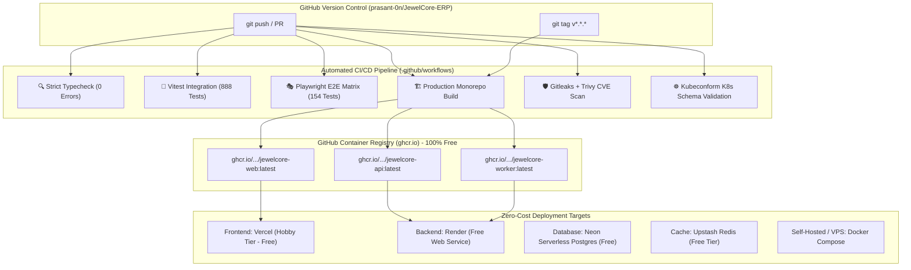

# JewelCore ERP - DevOps & Infrastructure Engineering Guide

Comprehensive guide to DevOps automation, CI/CD pipelines, container registries, zero-cost cloud deployments, and Kubernetes orchestration for **JewelCore ERP**.

---

## 1. DevOps Architecture Overview

JewelCore ERP employs an enterprise-grade, multi-stage automated delivery pipeline that operates **100% free of cost** using GitHub Actions, GitHub Container Registry (GHCR), and generous free-tier cloud platforms.



---

## 2. GitHub Actions CI/CD Pipeline Matrix

All workflows are located in [`.github/workflows/`](file:///home/prasanta/Documents/projects/JewelCore-ERP/.github/workflows/):

| Workflow | File | Trigger | Purpose |
|---|---|---|---|
| **Enterprise CI/CD** | [`ci.yml`](file:///home/prasanta/Documents/projects/JewelCore-ERP/.github/workflows/ci.yml) | Push/PR to `main` | Full gate: TypeScript strict check, Vitest 888 integration tests, Playwright 154 browser E2E tests, Production builds |
| **DevSecOps Gate** | [`security.yml`](file:///home/prasanta/Documents/projects/JewelCore-ERP/.github/workflows/security.yml) | Push/PR, Weekly Cron | Gitleaks secret & token scan, Aqua Trivy CVE filesystem scan, pnpm supply-chain audit |
| **Container Registry** | [`docker-publish.yml`](file:///home/prasanta/Documents/projects/JewelCore-ERP/.github/workflows/docker-publish.yml) | Push `main`, tags `v*` | Builds multi-tier images for `api`, `web`, `worker` with `type=gha` build cache and pushes to `ghcr.io` |
| **Continuous Deploy** | [`cd.yml`](file:///home/prasanta/Documents/projects/JewelCore-ERP/.github/workflows/cd.yml) | Successful CI on `main` | Triggers zero-downtime deployments to Vercel, Render, or generic webhooks |
| **Kubernetes Validation** | [`k8s-validate.yml`](file:///home/prasanta/Documents/projects/JewelCore-ERP/.github/workflows/k8s-validate.yml) | Changes in `k8s/**` | Kubeconform schema validation against K8s 1.30+ specification |
| **Release Management** | [`release.yml`](file:///home/prasanta/Documents/projects/JewelCore-ERP/.github/workflows/release.yml) | Tag `v*.*.*` | Verifies full suite and publishes GitHub Release with changelog |
| **CodeQL Security** | [`codeql.yml`](file:///home/prasanta/Documents/projects/JewelCore-ERP/.github/workflows/codeql.yml) | Push/PR, Weekly Cron | Static Application Security Testing (SAST) for JavaScript / TypeScript |

---

## 3. Zero-Cost Cloud Deployment Guide

You can run JewelCore ERP in production with **$0/month cloud infrastructure** using standard free tiers:

### 3.1 Architecture Overview (Zero-Cost Stack)
- **Frontend**: **Vercel** (Hobby Plan) or **Cloudflare Pages** — Free unlimited SSL, global CDN, and automated preview branches.
- **Backend API**: **Render** (Free Web Service) or **Fly.io** (Free tier) — Free HTTPS endpoint.
- **Background Worker**: **Render** (Free Background Worker) — Processes async BullMQ queues.
- **Database**: **Neon Postgres** (Free Tier) — 0.5 GB storage, instant branching, autoscaling to zero.
- **Redis**: **Upstash Redis** (Free Tier) — 10,000 commands/day free.

### 3.2 Automated Deployment Configuration
To enable one-click deployments from GitHub Actions, configure these repository secrets under **Settings > Secrets and variables > Actions**:

| Secret Name | Provider | Description |
|---|---|---|
| `VERCEL_DEPLOY_HOOK_URL` | Vercel | Webhook URL from Project Settings > Git > Deploy Hooks |
| `RENDER_API_DEPLOY_HOOK_URL` | Render | Deploy Hook URL from API Service Settings |
| `RENDER_WORKER_DEPLOY_HOOK_URL` | Render | Deploy Hook URL from Worker Service Settings |
| `DEPLOY_WEBHOOK_URL` | Custom/VPS | Generic webhook URL for external runners |

---

## 4. Local & Production Docker Runbook

### 4.1 Local Development (Databases Only)
To run local PostgreSQL and Redis dependencies in Docker while running application code on host:
```bash
# Start PostgreSQL (port 5434) and Redis (port 6380)
docker compose up -d

# Verify container health
docker compose ps
```

### 4.2 Full Production Stack (Docker Compose)
To run the complete production-grade multi-container topology (PostgreSQL, Redis, Migrations/Seeder, Express API, Next.js Web, BullMQ Worker):
```bash
# Build and launch all production containers
docker compose -f docker-compose.prod.yml up -d --build

# Inspect logs
docker compose -f docker-compose.prod.yml logs -f api web worker

# Stop containers
docker compose -f docker-compose.prod.yml down
```

---

## 5. Kubernetes Production Manifests

All enterprise manifests are located in [`k8s/`](file:///home/prasanta/Documents/projects/JewelCore-ERP/k8s/):

```
k8s/
├── namespace.yaml                # Isolated 'jewelcore' namespace
├── configmap.yaml                # Non-sensitive runtime environment configs
├── secrets.yaml                  # Base64/opaque operational secrets template
├── postgres-statefulset.yaml     # HA Persistent volume StatefulSet for Postgres
├── redis-deployment.yaml         # In-memory Redis cache & queue store
├── api-deployment.yaml           # Express REST API deployment + Service
├── web-deployment.yaml           # Next.js frontend deployment + Service
├── worker-deployment.yaml        # BullMQ background worker deployment
├── ingress.yaml                  # NGINX / Cloud Ingress controller routing
├── disaster-recovery/
│   ├── backup-cronjob.yaml       # Automated nightly pg_dump cronjob to S3/volume
│   └── restore-pitr.sh           # Point-in-time recovery restore script
└── monitoring/
    ├── prometheus-config.yaml    # Metrics scraping configuration
    ├── alertmanager-config.yaml  # SLA & outage alerting webhook targets
    ├── alertmanager-rules.yaml   # Critical threshold alert definitions
    └── grafana-dashboard.json    # Pre-built monitoring dashboard
```

To apply to a Kubernetes cluster:
```bash
kubectl apply -f k8s/namespace.yaml
kubectl apply -f k8s/configmap.yaml
kubectl apply -f k8s/secrets.yaml
kubectl apply -f k8s/postgres-statefulset.yaml
kubectl apply -f k8s/redis-deployment.yaml
kubectl apply -f k8s/api-deployment.yaml
kubectl apply -f k8s/web-deployment.yaml
kubectl apply -f k8s/worker-deployment.yaml
kubectl apply -f k8s/ingress.yaml
```

---

## 6. Disaster Recovery & Rollback Procedures

### 6.1 Database Automated Backups
The [`k8s/disaster-recovery/backup-cronjob.yaml`](file:///home/prasanta/Documents/projects/JewelCore-ERP/k8s/disaster-recovery/backup-cronjob.yaml) runs daily at 02:00 UTC, creating compressed PostgreSQL dumps with a 30-day retention policy.

### 6.2 Instant Point-In-Time Restore
To restore from a backup snapshot:
```bash
./k8s/disaster-recovery/restore-pitr.sh /path/to/backup.dump.gz
```

### 6.3 Immediate Service Rollback
If a newly deployed container version encounters issues:
```bash
# In Kubernetes:
kubectl rollout undo deployment/jewelcore-api -n jewelcore
kubectl rollout undo deployment/jewelcore-web -n jewelcore

# In Docker Compose:
docker compose -f docker-compose.prod.yml down
# Point IMAGE tag back to previous version in .env and restart:
docker compose -f docker-compose.prod.yml up -d
```
